# TerminalBuddy

<div align="center">

**基于 Tauri 2 + React 19 + Rust 的现代化多端终端工作台（桌面 · Web · 手机 · 安卓）**

[](terminal-buddy/package.json)
[](terminal-buddy/src-tauri/Cargo.toml)
[](terminal-buddy/package.json)
[](LICENSE)

<br />

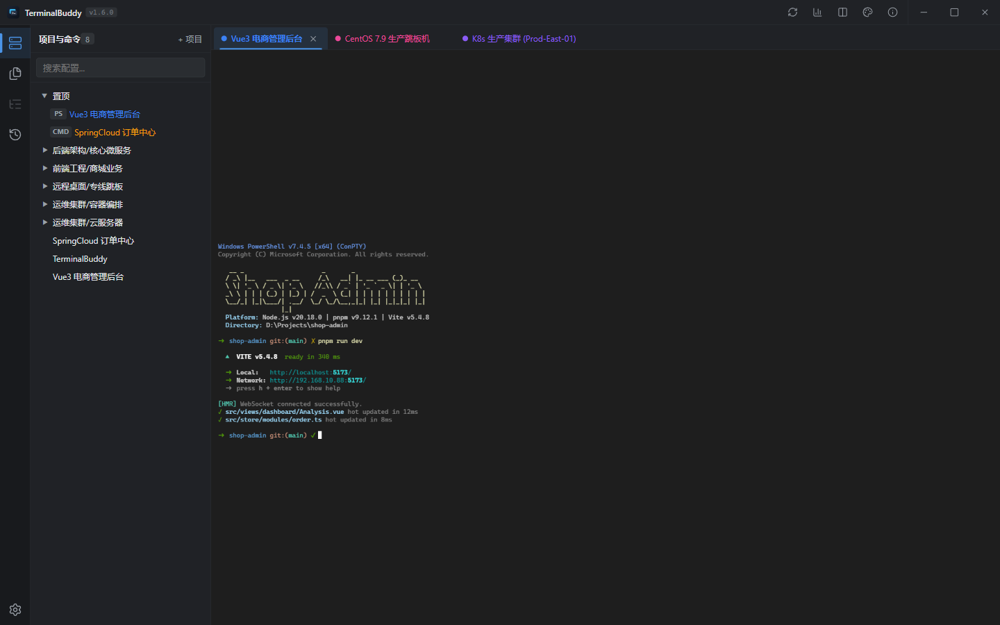

*高颜值深色质感 · VS Code 风格活动栏 · 多级层级分组 · 毫秒级 PTY 响应 · 桌面 / Web / 手机 / 安卓多端协同*

</div>

---

## 目录

- [一、核心操作动态演示](#一核心操作动态演示)
- [二、应用界面全景图解](#二应用界面全景图解)
- [三、基础配置全流程指南](#三基础配置全流程指南)
  - [1. 终端配置管理与多级层级分组](#1-终端配置管理与多级层级分组)
  - [2. 常用命令模板库与自定义快捷指令](#2-常用命令模板库与自定义快捷指令)
- [四、日常使用与深度体验指南](#四日常使用与深度体验指南)
  - [1. 多终端多任务分屏网格（左右 2×1 与四格 2×2）](#1-多终端多任务分屏网格左右-21-与四格-22)
  - [2. 本地工程文件树与内置 Monaco 编辑器](#2-本地工程文件树与内置-monaco-编辑器)
  - [3. Markdown 实时双向滚动同步分屏预览](#3-markdown-实时双向滚动同步分屏预览)
  - [4. 可视化 Git 历史图谱与代码 Diff 审查](#4-可视化-git-历史图谱与代码-diff-审查)
  - [5. SSH 远程运维与服务器实时监控仪表盘](#5-ssh-远程运维与服务器实时监控仪表盘)
  - [6. Claude Code 会话历史管理与交互回放](#6-claude-code-会话历史管理与交互回放)
  - [7. AI 多模型 Token 用量与额度监控](#7-ai-多模型-token-用量与额度监控)
  - [8. Web 远程管理与手机扫码免密连接](#8-web-远程管理与手机扫码免密连接)
  - [9. 全局设置中心与 16 色 ANSI 调色板定制](#9-全局设置中心与-16-色-ansi-调色板定制)
- [10. Agent CLI 管理与大模型供应商配置](#10-agent-cli-管理与大模型供应商配置)
- [11. 原生 AI 会话与安卓客户端](#11-原生-ai-会话与安卓客户端)
- [12. Codex 会话历史、任务摘要与断线恢复](#12-codex-会话历史任务摘要与断线恢复)
- [五、常用快捷键速查表](#五常用快捷键速查表)
- [六、技术架构与分层](#六技术架构与分层)
- [七、系统要求与安装使用](#七系统要求与安装使用)
- [八、安全与隐私设计](#八安全与隐私设计)
- [九、开源协议与致谢](#九开源协议与致谢)

---

## 一、核心操作动态演示

为直观展现 TerminalBuddy 的流畅体验与多功能联动，以下通过原生录制动图展示日常核心交互：

<table>
<tr>
<td width="50%" align="center">
<b>⚡ 终端启动、标签切换与左右分屏协同</b><br />
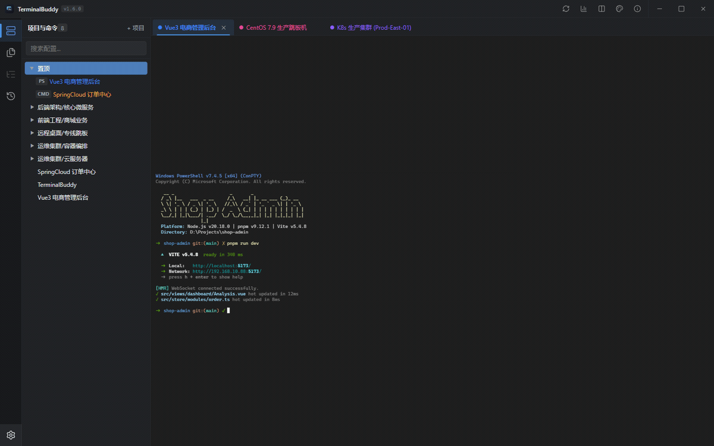
<br />
<p align="left"><sub><b>流程详解：</b><br />
1. 秒级拉起已配置的本地与远程终端会话；<br />
2. 点击多色指示灯标签页，在多个工程与服务器环境间零延迟平滑切换；<br />
3. 点击标题栏分屏按钮，瞬间进入左右 2x1 独立分屏网格，两套终端独立运行、协同监视。</sub></p>
</td>
<td width="50%" align="center">
<b>🗂️ 全能工作区与多功能侧栏联动</b><br />
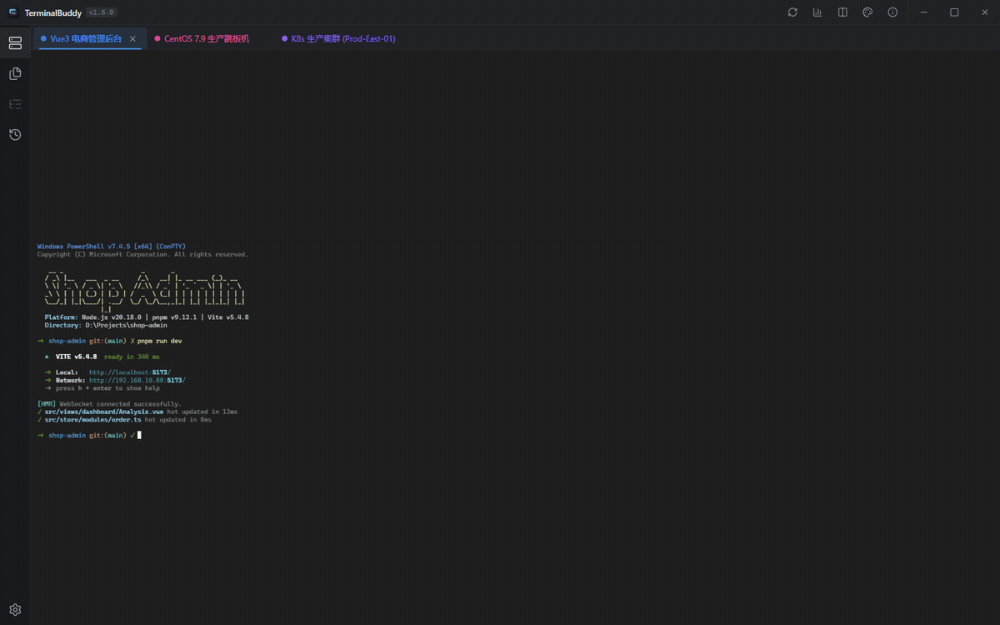
<br />
<p align="left"><sub><b>流程详解：</b><br />
1. 从「项目与命令」树形分组面板查看所有服务；<br />
2. 点击 Activity Bar 无缝切换至「文件与 Git」浏览工程结构；<br />
3. 打开 <code>App.vue</code> 在内嵌 Monaco Editor 中享受语法高亮；<br />
4. 切入 Git 历史查看多分支拓扑图谱与变更详情；<br />
5. 唤起全局设置中心调校主题色彩与偏好。</sub></p>
</td>
</tr>
</table>

---

## 二、应用界面全景图解

TerminalBuddy 融合了现代代码编辑器与专业终端模拟器的优秀界面范式，布局清晰、信息紧凑、视觉精致：

<div align="center">
  
</div>

### 界面结构解剖：

1. **无边框沉浸式标题栏（TitleBar）**
   - **左侧**：TerminalBuddy 品牌图标与当前版本号，提供面板显隐控制按钮；
   - **右侧**：集成状态动作群——**检查更新**、**AI 用量浮窗**、**一键分屏（单屏/双分屏/四分屏）**、**调色板主题切换**、**关于对话框**以及原生的 Windows 窗口最小化、最大化和关闭控制。
2. **VS Code 风格活动栏（Activity Bar）**
   - 位于界面最左侧，包含 4 大核心视图切换：**项目与命令**（`Server` 图标）、**文件与 Git**（`Files` 图标）、**会话标签**（`ListTree` 图标）、**Claude Code 会话**（`History` 图标），以及底部的**全局设置**齿轮入口。
3. **项目与命令导航侧栏（ConfigNav）**
   - **快速过滤**：顶部搜索框实时检索配置与命令；
   - **置顶分组**：高频使用的关键服务一键置顶显示；
   - **层级树形展示**：支持多级层级折叠（如 `前端工程/商城业务`、`后端架构/核心微服务`），每个配置带有鲜明的终端类型徽标（`PS`、`CMD`、`SSH`、`K8S`、`DK`、`RDP`）。
4. **多色彩指示灯标签栏（TerminalTabBar）**
   - 展示所有已打开的终端或编辑器会话；
   - 每个标签拥有独立的**会话类型图标**与**彩色呼吸灯/状态圆点**（24 色点阵支持），一眼区分生产与开发；
   - 支持 **F2** 快捷重命名、鼠标中键一键关闭、拖拽调整顺序。
5. **高性能 xterm.js 终端主体**
   - 基于 ConPTY 原生驱动与 WebGL 加速渲染，支持完整 24 位真彩色 ANSI 语法高亮与 ASCII 字符图形；
   - 内置智能命令补全浮窗，根据模板库与历史记录提供即敲即现的建议列表。

---

## 三、基础配置全流程指南

### 1. 终端配置管理与多级层级分组

在项目开发中，通常需要同时管理多个前后端服务、多台跳板机或容器环境。TerminalBuddy 提供了强大的配置模型（Profile）：

<div align="center">
  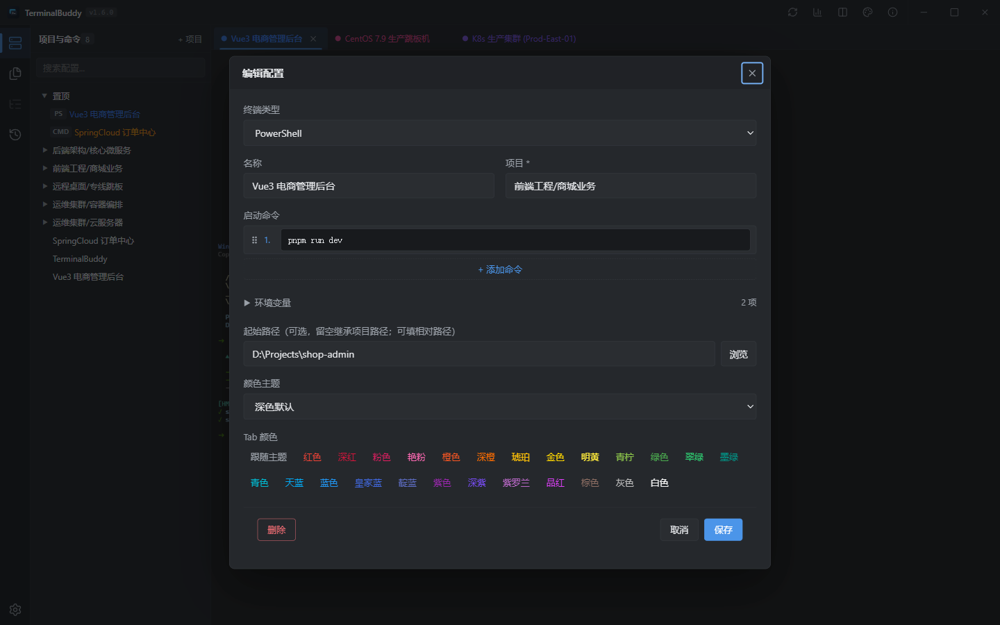
</div>

#### 配置参数详解：

- **终端类型（Terminal Type）**：
  - `PowerShell`：Windows 原生 PowerShell 环境；
  - `pwsh`：跨平台的现代 PowerShell 7+；
  - `CMD`：传统命令提示符，执行批处理更轻量；
  - `SSH`：直接建立远端 Linux SSH 安全会话（支持密码及密钥认证）；
  - `Docker`：一键自动执行 `docker exec -it` 进入指定容器；
  - `K8s`：直接连接 Kubernetes 指定 Namespace 下的 Pod 容器；
  - `MSTSC`：调用 Windows 原生远程桌面连接，凭证安全存储于系统凭据管理器。
- **项目/分组（GroupCascader 级联选择器）**：
  - 支持使用英文斜杠 `/` 进行多级层级分组，如 `前端工程/商城业务` 或 `运维集群/云服务器`；
  - 侧栏将自动渲染为层级折叠树，层次分明，逻辑清晰。
- **启动路径与启动命令**：
  - **起始路径**：终端启动时的默认工作目录；
  - **启动命令队列**：支持配置单条或多条命令（如 `pnpm run dev` 或 `mvn spring-boot:run`），启动后自动顺序输入执行。
- **环境变量注入**：支持为单个配置独立注入专有环境变量（如 `NODE_ENV=development`、`PORT=5173`），不污染系统全局变量。
- **Tab 标签颜色选择（24 色彩调色盘）**：
  - 支持从 24 种设计系统色板中选择标签指示灯颜色（红色、深橙、明黄、翠绿、天蓝、靛蓝、紫罗兰等），为高危生产环境与日常开发环境提供强烈的视觉区分。

---

### 2. 常用命令模板库与自定义快捷指令

日常运维与开发充斥着大量繁杂的长命令（如查看端口占用、强杀进程、Docker 容器清理、Git 回滚等）。TerminalBuddy 内置了分类完备的命令模板库，并支持完全自定义：

<div align="center">
  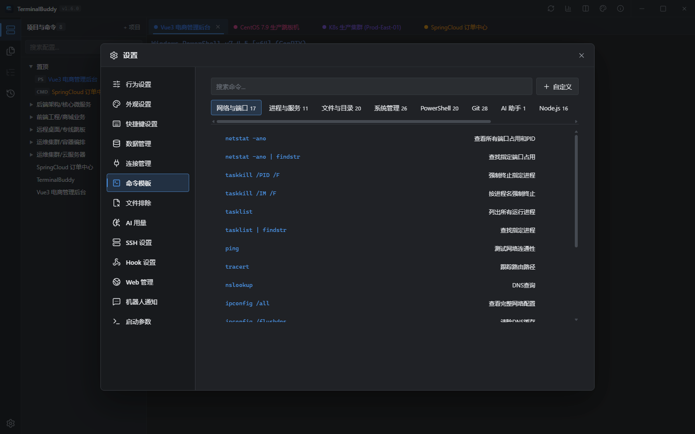
</div>

#### 模板库核心功能：

- **10 大预设分类**：包含网络与端口、进程与服务、文件与目录、系统管理、PowerShell 运维、Git 操作、Docker 容器、Node.js、Python 及 .NET 等 100+ 常用工程指令；
- **智能模糊搜索**：输入关键字（如 `端口`、`netstat`、`kill`）即可实时检索目标命令及中文用途说明；
- **自定义命令扩展**：支持点击「+ 自定义」随时添加团队专属脚本或长命令参数；
- **命令别名与隐藏**：可随时修改命令描述或将不常用的预置命令一键隐藏；
- **与终端输入框联动**：模板库与终端内的输入建议无缝打通，在终端键入命令前缀时即会自动弹出匹配的模板建议。

---

## 四、日常使用与深度体验指南

### 1. 多终端多任务分屏网格（左右 2×1 与四格 2×2）

分屏功能让开发者可以在一个屏幕内并行观察多个服务的运行输出，免去频繁切换窗口的烦恼。TerminalBuddy 提供了业界顶级的多终端网格布局体验：

<table>
<tr>
<td width="50%" align="center">
<b>左右双分屏模式（2×1 Split）</b><br />
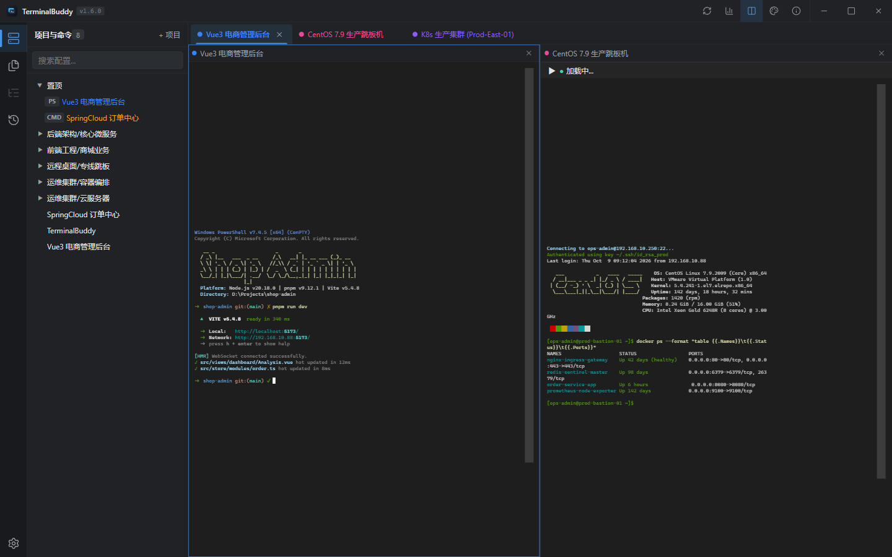
<br />
<sub>左侧前端 Vite 热更新日志，右侧 Linux SSH 生产跳板机，双屏并排监视</sub>
</td>
<td width="50%" align="center">
<b>四格矩阵分屏模式（2×2 Grid）</b><br />
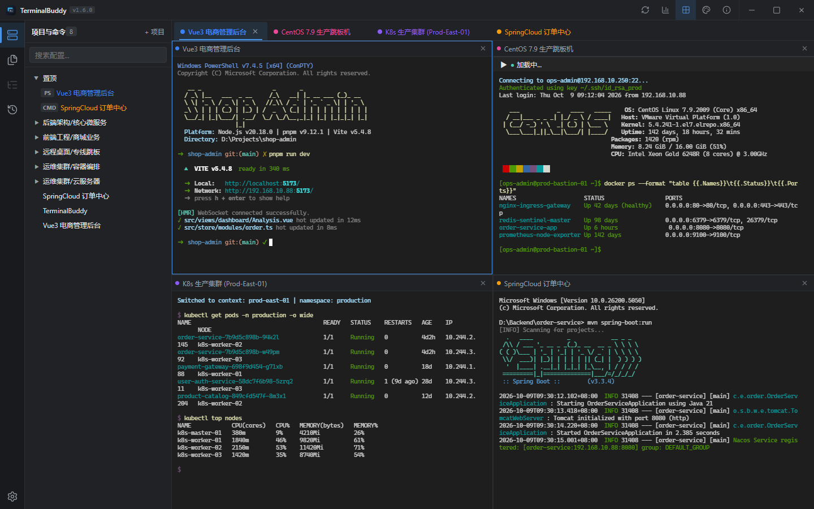
<br />
<sub>前端、跳板机、K8s 集群与 SpringCloud 微服务同屏四网格并行运转</sub>
</td>
</tr>
</table>

#### 分屏操作技巧：

- **一键切换布局**：点击标题栏分屏按钮（或快捷键），即可在 **单屏模式** ➔ **左右双分屏（2×1）** ➔ **四格分屏（2×2）** 之间循环切换。
- **会话自由调度**：
  - 在分屏状态下，点击顶部标签栏的任意终端，该终端即刻置入当前聚焦的分屏槽位；
  - 拖拽分屏槽位头部的拖拽手柄，可在网格之间直接**对调位置**；
  - 每个分屏网格拥有独立的关闭按钮，关闭槽位不影响后台会话。
- **独立分屏字号优化**：针对双分屏、四分屏空间紧凑的特点，设置中心支持独立配置不同分屏下的字号大小（如单屏 14px、双屏 12px、四屏 11px），保障各终端排版美观、文字清晰不折行。

---

### 2. 本地工程文件树与内置 Monaco 编辑器

TerminalBuddy 内置了轻量级开发工作台，查看配置文件与修改源码无需拉起外部臃肿编辑器：

<div align="center">
  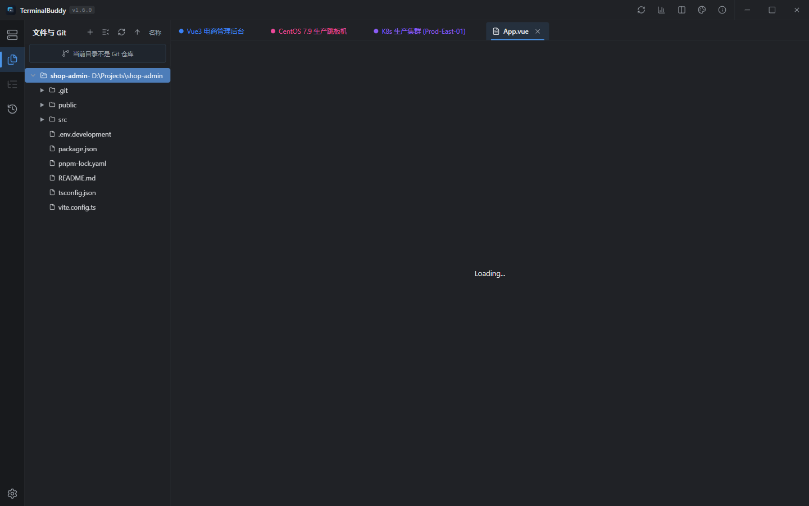
</div>

#### 特色能力介绍：

- **工程文件树快速导航**：
  - 点击活动栏的「文件与 Git」图标展开工程目录树；
  - 智能识别常见文件格式并渲染专属扩展名图标；
  - 支持排除规则（在设置中定义过滤 `node_modules`、`.git`、`dist` 等大目录）。
- **VS Code 同款 Monaco Editor 体验**：
  - 双击文件树中的源码文件，在工作区以新标签页秒级打开；
  - 拥有完整的语法高亮、代码缩进参考线、行号、括号色彩匹配与右侧代码缩略图（Minimap）；
  - 完整的常用快捷键支持：`Ctrl+F` 查找、`Ctrl+H` 替换、`Shift+Alt+F` 格式化文档。
- **磁盘版本冲突防护**：当检测到外部编辑器修改了当前文件时，顶部弹出优雅横幅并支持并排 Diff 对比合并，防止代码被意外覆盖。

---

### 3. Markdown 实时双向滚动同步分屏预览

在编写项目说明、接口文档或变更日志时，无需打开浏览器即可实时预览渲染效果：

<div align="center">
  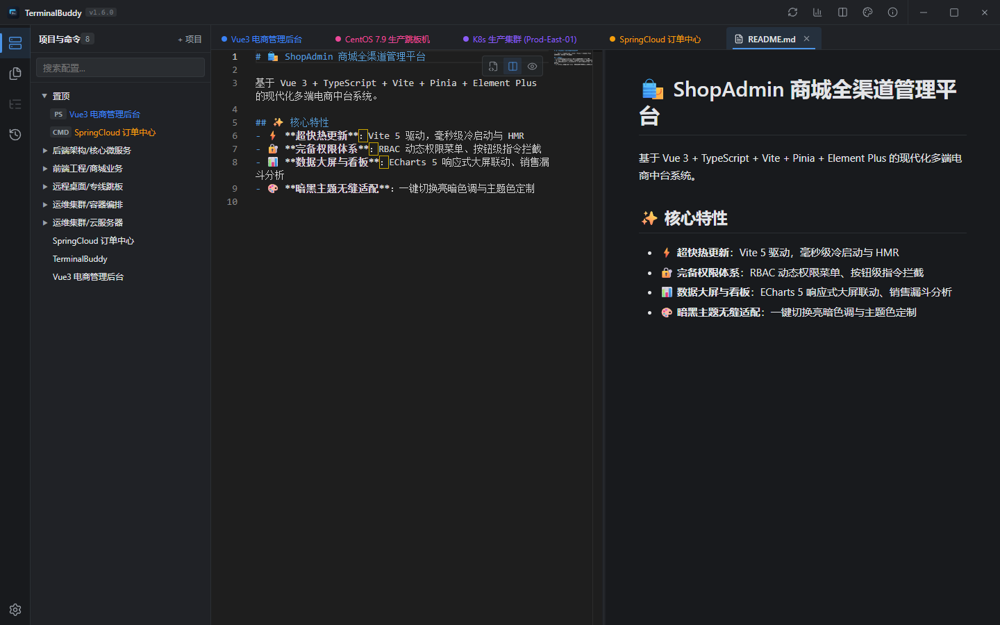
</div>

#### Markdown 编写体验：

- **三态视图自由切换**：右上角提供「源码模式」、「分屏模式」与「纯预览模式」一键切换；
- **双向滚动同步（Scroll Sync）**：左侧 Monaco 编辑器滚动时光标所在的章节，右侧预览区域精准跟随同步；右侧滚动时左侧代码光标亦同步跟随；
- **现代美观渲染引擎**：支持 GitHub 风格 Markdown、语法高亮代码块、表格、任务清单与 Emoji 徽章，排版清晰美观。

---

### 4. 可视化 Git 历史图谱与代码 Diff 审查

内置原生的 Git 版本控制图形化视图，将复杂的提交分支历史变为直观的拓扑图谱：

<div align="center">
  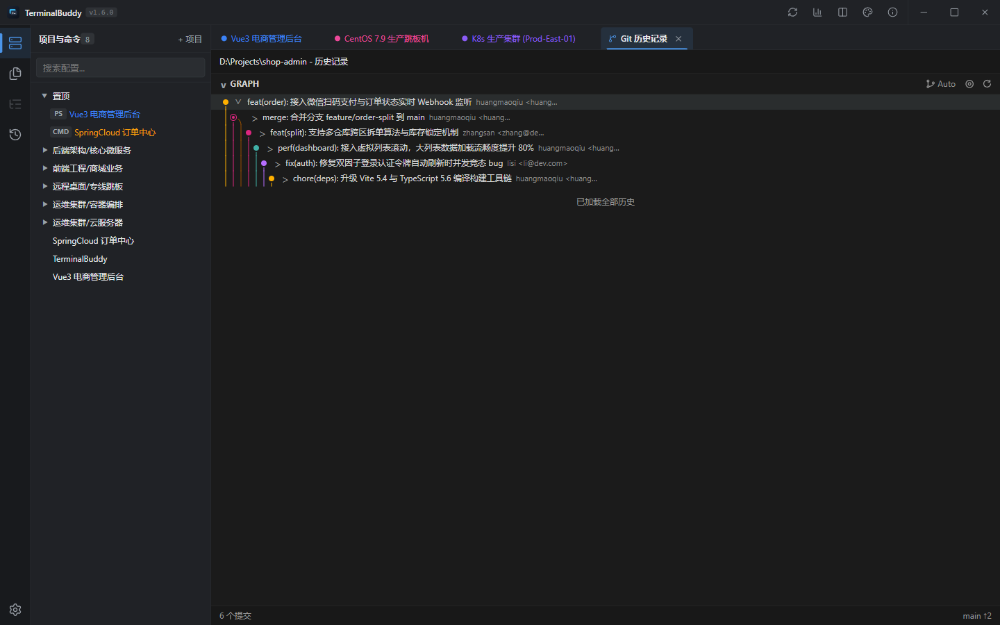
</div>

#### Git 视图亮点：

- **多分支 SVG Commit-Graph 拓扑树**：
  - 主干分支（黄色）、特性分支（紫色/青色）与合并节点（双圆环）清晰分明；
  - 完整的连线逻辑生动展现分支的分离与 Merge 合并全过程。
- **分支 Ref 状态标记**：
  - 直观标注当前本地分支（`main`）、远程追踪分支（`origin/main`）及各类特性分支徽标；
  - 一目了然查看本地超前（ahead）与落后（behind）提交数。
- **规范化提交信息与代码审查**：
  - 列表清晰展示提交哈希、提交说明（Message）、作者邮箱与提交时间；
  - 点击提交项展开变更文件列表，并支持接入 Monaco DiffEditor 进行绿色新增、红色删除的逐行代码差异比对。

---

### 5. SSH 远程运维与服务器实时监控仪表盘

连接生产环境或云服务器跳板机时，TerminalBuddy 能够即时变身全能运维驾驶舱：

<div align="center">
  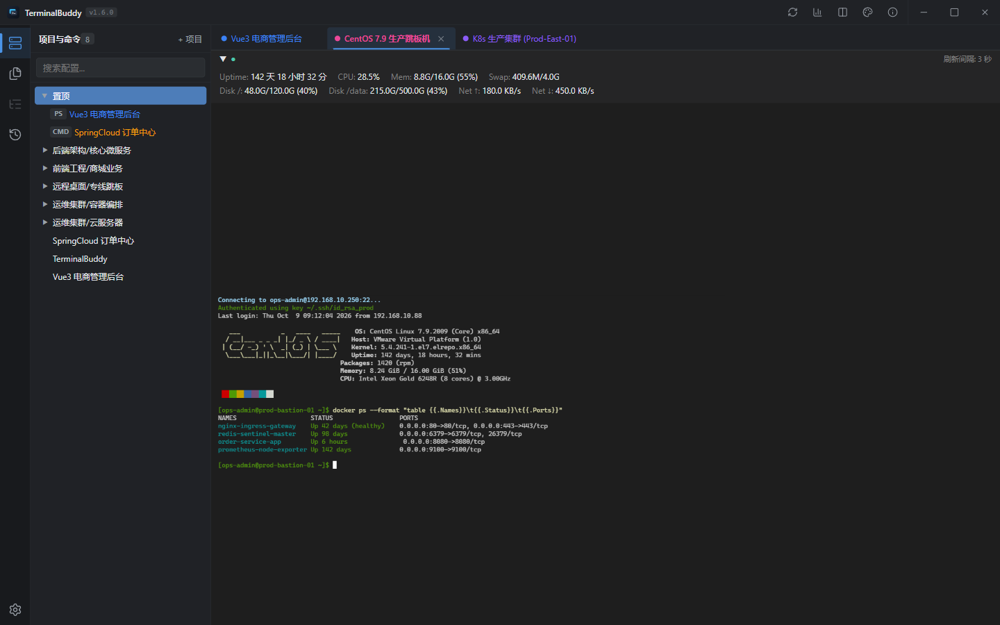
</div>

#### 运维管理核心特性：

- **真彩 SSH 会话**：ConPTY 底层完美支持 xterm-256color 及 24 位真彩色，CentOS、Ubuntu 的 Fastfetch / Neofetch ASCII Logo、系统高亮提示、htop 界面完美渲染无乱码。
- **顶部实时服务器监视条（ServerMonitor）**：
  - 针对 SSH 终端，顶部常驻实时性能指标小条：`● CPU 29% | Mem 55% | Disk 40% | ↑180.0 KB/s ↓450.0 KB/s`；
  - 点击展开即呈现详尽的双行服务器仪表盘卡片：
    - 🖥️ **CPU 负载**：多核实时占用率百分比；
    - 💾 **内存与 Swap**：物理内存（已用/总量/使用率）与 Swap 交换分区；
    - 💽 **磁盘多挂载点**：根分区 `/` 与数据分区 `/data` 的空间余量；
    - 🌐 **实时网络流量**：网卡实时上行（Net ↑）与下行（Net ↓）吞吐速率；
    - ⏱️ **系统运行时间（Uptime）**：服务器持续在线运行天数。

---

### 6. Claude Code 会话历史管理与交互回放

针对重度使用 Claude Code 智能体进行软件研发的开发者，TerminalBuddy 深度打通了会话元数据层：

<div align="center">
  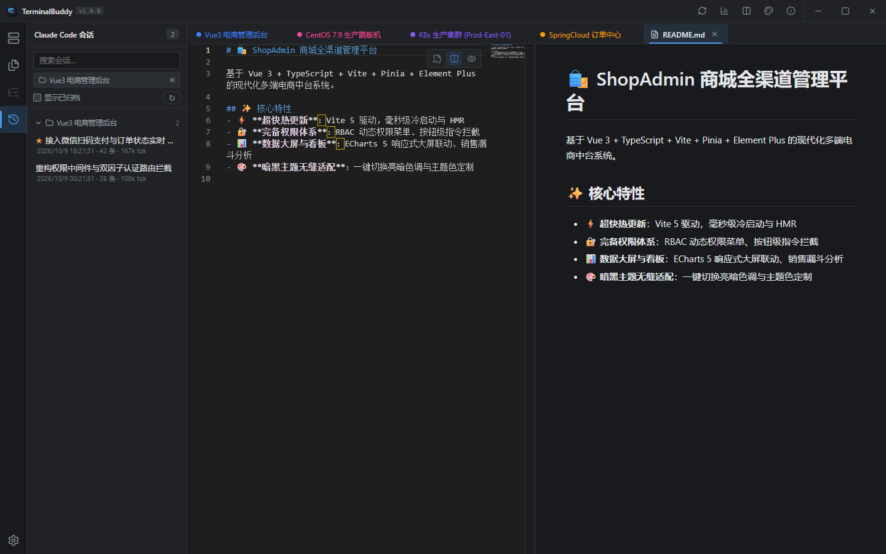
</div>

#### 会话管理特性：

- **按工程目录自动聚合**：自动扫描并解析 `~/.claude` 目录历史，按当前工程目录自动过滤分组呈现；
- **重要会话金星收藏**：支持为关键重构任务点亮金星收藏，并支持标记归档会话；
- **全方位指标统计**：实时显示每场会话的交互轮数（Message Count）、消耗的 Input/Output Token 数量与所使用的模型版本（如 `claude-3-7-sonnet`）；
- **全文检索与一键恢复（Resume）**：支持在历史会话中搜索关键词并快速定位，右键点击即可自动在项目目录下执行 `claude --resume <id>` 恢复上下文。

---

### 7. AI 多模型 Token 用量与额度监控

集中化的大模型 API 用量中心，告别在多个云厂商控制台之间繁琐登录：

<div align="center">
  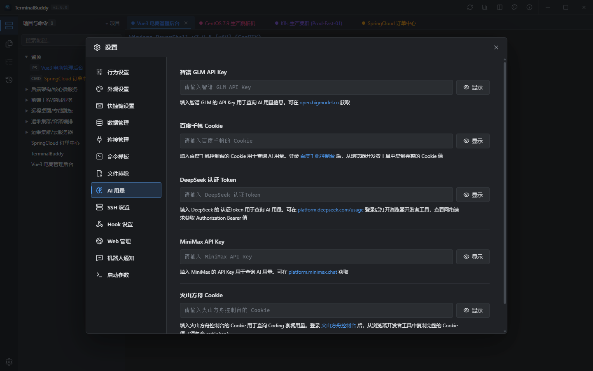
</div>

#### 监控与管理项：

- **支持主流大模型服务商**：集中管理智谱 GLM API、百度千帆平台、DeepSeek 官方平台、MiniMax 以及火山方舟（ByteDance Ark）；
- **用量与余额直观呈现**：标题栏点击统计图表按钮即可弹出用量浮窗，清晰展示当日请求次数、输入/输出 Token 统计、Prompt 缓存命中率与调用费用估算；
- **凭据安全密文脱敏**：Key 与 Cookie 提供一键显隐查看功能，密文加密保存在本地配置中。

---

### 8. Web 远程管理与手机扫码免密连接

无需安装额外客户端，内置的嵌入式 axum Web API 让任意设备（手机、平板、异地电脑）通过浏览器即可直接接管终端：

<div align="center">
  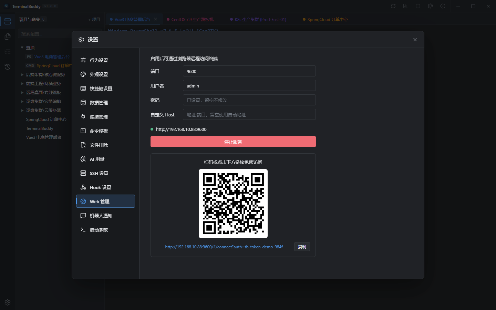
</div>

#### Web 远程连接优势：

- **轻量嵌入式服务**：基于 Rust axum 打造的高性能轻量 Web 服务，资源开销几乎为零；
- **浏览器直达桌面同款界面**：电脑或手机浏览器打开服务地址即进入与桌面端一致的完整工作界面，扫描二维码 / 点击快捷链接可携 token 免密进入；
- **局域网自动寻址与二维码生成**：自动识别本机局域网 IP（如 `http://192.168.10.88:9600`）并生成大尺寸高清二维码，手机相机扫码即可秒级免密接入；
- **PC / Web 严格会话隔离**：通过底层状态机实现物理隔离（`webApiShareSessions`），保障桌面本地私密终端不被外部意外窃视。

---

### 9. 全局设置中心与 16 色 ANSI 调色板定制

设置中心采用现代化的多分区侧栏结构，所有修改即时生效并自动持久化：

<div align="center">
  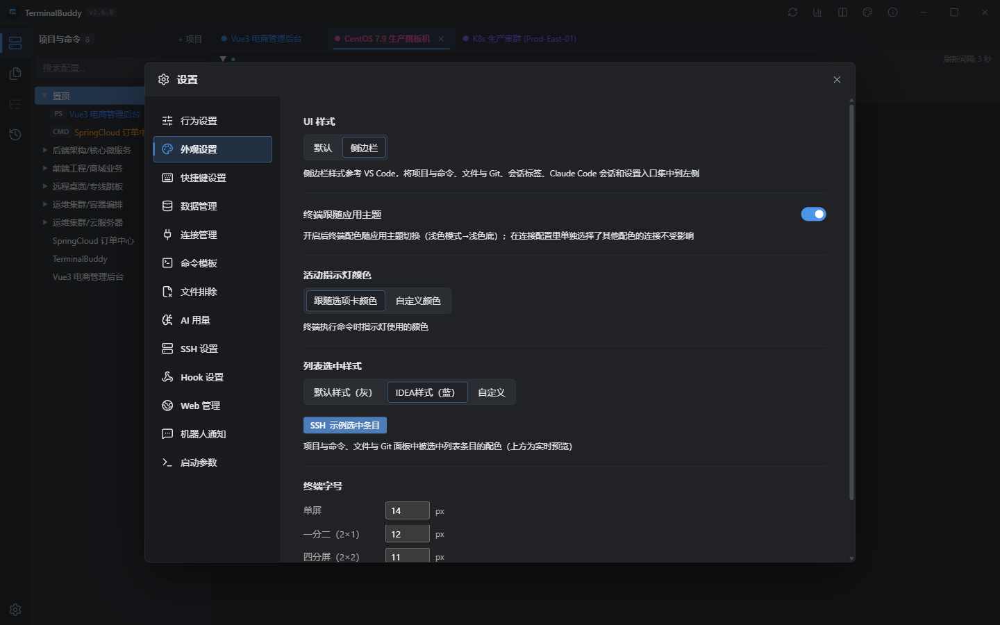
</div>

#### 设置分区与个性化配置项：

- **行为设置**：
  - **启动时恢复选项卡**：下次打开程序自动恢复上次打开的所有终端会话；
  - **开机自启动**与**启动窗口模式**（窗口化 / 最大化）；
  - **关闭行为**：选择点击关闭按钮是直接退出还是最小化到系统托盘。
- **外观设置**：
  - **UI 样式双模式**：支持经典全开展开模式与现代 VS Code 风格侧边栏模式；
  - **列表选中风格**：支持 IDEA 经典蓝（`#4d7db9`）与现代默认灰样式实时切换；
  - **分屏终端字号阶梯**：单屏、双分屏、四分屏字号独立调校。
- **主题设置与 16 色调色板**：
  - 内置 8 款经典主题：深色默认、黑客绿、海洋蓝、PS深色、浅色、Solarized暗、Solarized亮、复古绿屏；
  - 提供 16 色标准 ANSI 调色板编辑器（黑、红、绿、黄、蓝、洋红、青、白及其高亮对应色），所见即所得实时预览。

---

### 10. Agent CLI 管理与大模型供应商配置

- **Agent CLI 统一管理**：自动检测 Claude Code / Codex CLI 的安装状态与可执行路径（覆盖 npm shim 与 winget / Volta / pnpm / scoop 等安装目录），支持应用内一键安装 / 更新、版本显示与逐项检查更新，后台执行互斥防并发；国内镜像（npmmirror）与官方源可切换，每个工具可自定义基础启动命令；
- **大模型供应商管理**：集中维护多家 API 供应商（增删改查、API Key 加密落盘），每个模型可配置上下文窗口与推理档位（effort：low / medium / high / xhigh / max）；Claude / Codex 双分页编辑，切页不丢编辑状态，Provider 支持拖拽排序与可自由输入的模型组合框；
- **指定模型启动**：连接与项目右键菜单新增 Claude 模型子菜单，指定模型启动并继承原命令参数，恢复历史会话同样支持指定模型；标签与侧栏以描边「模型 chip」展示所用模型；
- **Claude 默认配置面板**：`~/.claude/settings.json` 图形化读写、深合并写回并自动保留最近 10 份快照备份；
- **Web / 手机端同步**：提供同款 Agent / Provider 管理面板，活动状态实时推送。

---
### 11. 原生 AI 会话与安卓客户端
除在终端中使用 Claude Code / Codex 外，服务端还内置原生 AI 会话能力，并配套全新的安卓原生客户端：

- **原生 AI 会话**：会话保存在服务端 `AiSessions/*.json`，可选择供应商与模型（仅列出项目已启用的 Agent，继承服务端权限配置）；支持流式回复、中断、Codex 操作确认卡片与断线重连补偿，接口详见 [docs/原生AI会话API.md](docs/原生AI会话API.md)；
- **安卓原生客户端**（`android/`，Kotlin + Jetpack Compose）：账号密码登录后即可选择项目、供应商与模型开始对话；流式逐字显示、工具执行日志折叠展示、跟随滚动与「回到最新」、浅色 / 深色主题切换；登录令牌经 Android Keystore 加密存储，会话保存在服务端，App 退到后台任务继续执行；
- **连续发送方式（App）**：安卓客户端支持「排队发送」（默认）与「原生插话」两种方式（首页菜单「发送方式」）——回复期间发送的消息默认在服务端排队（App 被杀也不丢失），等当前回合任务（含后台任务）全部完成后由服务端写入同一个 CLI 进程继续，不重启进程也不需要恢复历史；原生插话则把消息直接交给运行中的 CLI 进程，由它选择合适节点接收，不中断当前任务；排队列表中每条可点发送箭头单独插话；
- **历史会话恢复（App）**：安卓客户端新增「历史会话」折叠区——展开即按当前项目 + Agent 列出电脑端 CLI 的转录历史（Claude / Codex 共用同一索引，展开前自动增量扫描），点击任意一条即在服务端创建绑定原会话线程的原生会话并预填最近消息：Claude 走 `claude --resume`、Codex 走 `thread/resume`，继续对话即无缝续接；同一历史线程重复恢复自动复用已有会话；

---
### 12. Codex 会话历史、任务摘要与断线恢复
- **Codex 会话历史**：扫描索引 `CODEX_HOME` 下的 rollout 会话文件（自动去重备份副本），与 Claude 历史共享同一面板，支持列表 / 全文搜索 / 重命名 / 置顶 / 删除 / 导出与回放；历史会话可按项目目录匹配 Profile，在新终端以 `codex resume` 续接；
- **任务摘要标签**：终端启动时自动记录终端与 Claude / Codex 会话的绑定关系，从会话转录生成任务标题；桌面标题栏、会话树与 Web 页签均显示摘要（外观设置可开关）；
- **会话可靠恢复**：后台定时落盘运行中 Claude 会话的 session ID，容器重启后按已保存页签自动重建终端并续接会话，配合一次性租约机制防止多个浏览器客户端并发重复恢复。

---
## 五、常用快捷键速查表

| 按键 / 快捷键 | 作用区域 | 功能说明 |
|---|---|---|
| `F2` | 标签栏 / 配置树 | 快速内联重命名当前选中的终端标签或配置 |
| `F11` | 全局窗口 | 快速切换工作区全屏与窗口化模式 |
| `Ctrl + F` | 终端 / 编辑器 | 唤起终端搜索条 / 编辑器查找替换浮窗 |
| `Ctrl + Shift + F` | Monaco 编辑器 | 代码查找与替换 |
| `Shift + Alt + F` | Monaco 编辑器 | 对当前打开的代码文档进行自动格式化 |
| `鼠标中键单击` | 标签栏 | 直接关闭目标标签页会话 |
| `鼠标右键长按` | 终端区域 | 触发右键快捷粘贴（内置去重与智能过滤） |
| `拖拽文件` | 终端区域 | 将文件路径自动转换为适合当前 Shell 格式的路径文本 |
| `Ctrl + 滚轮` | 终端区域 | 快速缩放当前终端字号大小 |

---

## 六、技术架构与分层

TerminalBuddy 采用了现代桌面软件的高性能分层架构，兼顾了底层系统资源的高效调度与上层界面的高颜值响应：

```
┌────────────────────────────────────────────────────────┐
│               React 19 前端 (Zustand 状态机)             │
│   (ActivityBar / ConfigNav / TerminalPanel / Monaco)   │
├────────────────────────────────────────────────────────┤
│                 Tauri IPC 命令桥 (JSON)                 │
├────────────────────────────────────────────────────────┤
│                      Rust 服务层                       │
│  (ProfileService / GitService / SshService / FsService) │
├────────────────────────────────────────────────────────┤
│      ConPTY / Win32 API / axum HTTP Server / libssh2   │
└────────────────────────────────────────────────────────┘
```

- **桌面前端**：React 19 + TypeScript + Zustand 5 + xterm.js 6，利用轻量级状态切片（Slices）管理会话、标签与文件树；
- **IPC 桥接层**：强类型安全的 Tauri Invoke 桥接通道，数据采用标准的 camelCase 序列化；
- **底层后端**：Rust (edition 2021)，通过 `portable-pty` 直接与 Windows 内部的 ConPTY 虚拟终端通信；基于 Win32 原生 API 保证密码凭证安全；
- **网络与服务**：内置基于 axum 的高性能异步 Web API，支持移动端/跨终端无缝连接。
- **Web 前端**：桌面端 `src/` 以 browser 模式构建出完整网页界面（dist-web），由内嵌 Web API 同源托管；独立手机 SPA（`web/`）已于 2026-10 退役，不再随任何构建打包；
- **Android 客户端**：Kotlin + Jetpack Compose 原生应用（`android/`），通过 Web API（REST + WebSocket）提供原生 AI 对话能力。

---

## 七、系统要求与安装使用

### 系统要求

| 项目 | 最低配置 | 推荐配置 |
|---|---|---|
| 操作系统 | Windows 10 (1903+) | Windows 11 (64位) |
| 处理器 | 双核 2.0 GHz | 四核 3.0 GHz 及以上 |
| 运行内存 | 4 GB | 8 GB 及以上 |
| 存储空间 | 200 MB 可用空间 | 500 MB 可用空间 |
| 分辨率 | 1280 × 720 | 1920 × 1080 及以上 |

### 安装程序下载

前往项目的 [Releases 发行页面](https://gitee.com/updateme/terminal-buddy/releases) 下载最新发行版：

- `TerminalBuddy_Setup.exe` — Windows NSIS 极速安装包（推荐，自动创建桌面快捷方式）
- `TerminalBuddy_Portable.zip` — 免安装绿色便携版（解压即用）

### 本地编译与开发构建

如果你希望自行构建或参与开发：

```bash
# 1. 克隆代码仓库
git clone https://gitee.com/updateme/terminal-buddy.git
cd terminal-buddy/terminal-buddy

# 2. 安装前端依赖
npm install

# 3. 启动开发模式（Tauri 桌面容器 + 前端热更新）
npm run tauri dev

# 4. 编译生产环境安装包
npm run tauri build
```

---

### Docker 服务器部署与多端构建
除 Windows 安装包外，还提供服务器 / NAS 部署与跨平台构建方式：

- **Docker 服务器部署**：在电脑或手机浏览器中使用与桌面同款的功能，详见 [DEPLOY_README.md](DEPLOY_README.md) 与 [docs/Docker与完整网页界面.md](docs/Docker与完整网页界面.md)；
- **飞牛 fnOS 一键部署**：执行 `./xcj/deploy-fnos.sh` 将 TerminalBuddy 部署到飞牛 NAS，默认在开发机本机构建镜像后上传（需 Docker；构建复用 BuildKit 层缓存），飞牛只负责载入镜像与重建容器，内置写入探测、健康检查与失败自动回退；
- **Linux 交叉编译 Windows 单文件 exe**：仓库根目录执行 `./xcj/build-windows-exe.sh`，在 Linux 本机使用 cargo-xwin 交叉编译（首次自动补齐 Rust / cargo-xwin 与 `~/.cache/terminal-buddy/xwin` 下的 Windows SDK 缓存），产出 `dist/` 下的单文件 exe 与 `.sha256` 校验；构建成功后自动归档到 `/mnt/fnos/code/`（不可用时保留在 `dist/`）；
- **Android 客户端构建**：Linux 上在仓库根目录执行 `./xcj/build-android.sh`，在本机使用 JDK 17+、Android SDK 36 与 Gradle 构建 Release APK（首次自动下载 SDK 到 `~/.android-sdk`），并用 apksigner 校验签名；产出 `dist/` 下的 APK 与 `.sha256`，构建成功后自动归档到 `/mnt/fnos/code/`（不可用时保留在 `dist/`）。也可 `cd android && ./gradlew :app:assembleDebug`（详见 [android/README.md](android/README.md)），Windows 直装设备用 `scripts/build-android.bat`。

---
## 八、安全与隐私设计

- **PC / Web 会话物理隔离**：Web 远程访问默认与桌面会话严格隔离（`webApiShareSessions: false`），防止外部未经授权查看桌面终端输出。
- **系统级凭据安全保护**：远端主机密码通过 Windows 原生 `CredWriteW` API 加密存储于系统的凭据管理器（Credential Manager），杜绝在进程命令行或明文文件中泄漏。
- **高安全 HTTP 认证**：内置 Web API 采用 JWT 令牌认证与自适应 Bcrypt 密码哈希，具备防暴力破解限流机制。
- **登录状态长期保持**：JWT 有效期 30 天，服务重启后保持登录，减少频繁重复登录；
- **安卓端令牌安全**：登录令牌经 Android Keystore AES/GCM 加密存储，密码不落盘，鉴权失效自动清除登录态。

---

## 九、开源协议与致谢

本项目基于 [MIT 许可证](LICENSE) 开源。

特别鸣谢以下优秀开源项目为 TerminalBuddy 提供的强力支撑：

- [Tauri](https://tauri.app/) — 现代、轻量、安全的桌面应用框架
- [xterm.js](https://xtermjs.org/) — 工业级 Web 终端模拟核心
- [React](https://react.dev/) — 声明式组件化用户界面构建库
- [Monaco Editor](https://microsoft.github.io/monaco-editor/) — 微软出品的桌面级代码编辑引擎
- [portable-pty](https://github.com/wez/portable-pty) — 跨平台 PTY 管理库
- [lucide-react](https://lucide.dev/) — 优雅、统一的现代化矢量图标库