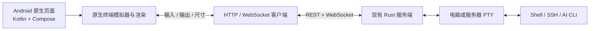

# Android 原生终端版本方案调研

调研日期：2026-10-21。依据：当前仓库源码、Android/Tauri 官方文档及原生终端组件的公开源码。范围为技术方案，不涉及客户端实现。

## 结论

**可以实现终端页面纯原生。首版建议新增 Kotlin + Jetpack Compose Android 客户端，通过现有 REST/WebSocket 接口连接 TerminalBuddy 桌面端或独立服务器端。**

终端的字符网格、光标、滚动、选择、输入法和工具栏由 Android 原生组件处理，页面无需 WebView。命令继续在电脑或服务器的 PTY 中执行。原生渲染与命令运行位置是两个独立问题。

原生终端组件建议优先对 **ConnectBot termlib** 做适配原型，以 **Termux terminal-emulator / terminal-view** 为备选。终端模拟器具有较高复杂度，不建议自行从零实现 ANSI/VT 解析和渲染。

本方案优先假设：第一版是远程客户端，不要求手机本地运行开发工具，也不要求脱离现有服务端直接 SSH。后两项可作为独立阶段增加。

## 当前项目为什么适合

| 已有能力 | 源码依据 | Android 复用方式 |
| --- | --- | --- |
| 登录、配置、项目、会话管理 REST API | `terminal-buddy/src-tauri/src/web/server.rs` | 原生 HTTP 客户端直接调用 |
| 终端输入输出 WebSocket | `terminal-buddy/src-tauri/src/web/ws.rs` | 原生 WebSocket 接管网络层 |
| 输入、尺寸、输出、回放、实际视口、退出和错误消息 | `terminal-buddy/src-tauri/src/models/web_api.rs:123` | Kotlin 定义对应消息模型 |
| 现成的连接、重连和首帧尺寸流程 | `terminal-buddy/web/src/hooks/useTerminalWs.ts` | 移植协议行为和状态机，UI 重写 |
| 按历史网格尺寸回放、回放期间阻止输入回传 | `terminal-buddy/web/src/components/Xterm.tsx` | 在原生模拟器中实现相同行为 |
| 会话共享、接管、关闭权限 | `terminal-buddy/src-tauri/src/models/terminal_access.rs` | 保留服务端统一权限判定 |
| 独立无桌面服务器入口 | `terminal-buddy/src-tauri/src/server_main.rs`、`runtime.rs` | Android 可连接独立服务或 Docker 部署 |
| Windows / Unix Shell 分支 | `terminal-buddy/src-tauri/src/commands/terminal.rs:44` | 服务端保留平台差异，Android 无需移植 PTY |

现有 `Cargo.toml` 已有 `desktop` / `server` feature 和独立服务器二进制。源码中 Windows 基座为 `cmd.exe`，Unix 默认 `/bin/bash`，可通过 `TERMINAL_BUDDY_SHELL` 覆盖；当前代码已经具备服务器方向的拆分基础。

**主要复用的是服务端功能、接口、数据模型和交互规则。React 页面、xterm.js 和 Zustand 不能直接作为 Android 原生 UI 使用。**

## 推荐架构

Android 侧建议包含：

- Compose：登录、服务地址、项目/配置列表、多会话、终端工具栏。
- 原生终端组件：负责终端协议解析、网格渲染、滚动、文本选择和键盘编码。
- OkHttp + Kotlin 协程：REST、WebSocket、网络切换和重连。
- ViewModel + StateFlow：页面状态与会话状态；会话对象的寿命独立于页面重组。
- Android Keystore 支持的凭据存储：保存令牌等敏感连接信息。

终端组件应与传输层解耦，形成“接收输出、发送输入、调整尺寸、连接状态、释放资源”的会话适配接口。未来增加直接 SSH 或本地 PTY 时，可以继续复用终端页面。

建议在仓库新增独立 `android/` 工程。原生客户端直接管理网络与会话，首版无需在手机内嵌现有 Rust 服务端。

## 原生终端组件比较

| 候选 | 原生实现及接入方式 | 优点 | 当前需要解决的问题 |
| --- | --- | --- | --- |
| ConnectBot termlib | Kotlin / Compose Canvas + libvterm JNI；调用 `writeInput()` 喂入输出，通过 `onKeyboardInput` 取回输入 | 模拟器与连接独立；适合直接接 WebSocket；提供触摸选择、缩放、输入法及尺寸回调 | 当前仍处于 0.x；缩放文本重排存在已知限制；需确认中文和目标 CLI 兼容性 |
| Termux 终端组件 | Java 原生 View / Canvas + 终端模拟器；Compose 可用 `AndroidView` 嵌入 | 长期真实终端使用经验，常见 Shell/TUI 场景成熟 | `TerminalView.attachSession()` 依赖 `TerminalSession`，后者是 `final` 且绑定本地 JNI PTY；需改造会话接口以接远程传输 |
| libvterm / Rust 解析内核 + 自研原生 View | 自己实现字体、网格、输入法、选择与绘制 | 控制范围最大 | 工作量及维护成本最高，不适合作为首版 |

### termlib 的关键发现

其模块文档明确说明它是显示组件，PTY、SSH 和 I/O 由调用方负责，提供：

- `TerminalEmulatorFactory.create(onKeyboardInput = ...)`
- `emulator.writeInput(data, offset, length)`
- `emulator.resize(...)`、尺寸变化回调和 `Terminal(...)` Compose 组件。
- 粘贴、键盘显示控制、临时暂停 resize、固定网格尺寸等接口。

仓库根 README 将部分功能列为计划，但模块文档与公开 API 已包含粘贴和固定尺寸接口，因此应以选定版本的 API 与实现为准。

当前主分支变更记录列至 `0.3.14`；其中 `0.3.11` 明确写出：暂时禁用 resize 时的文本重排，直到滚动历史、宽字符和元数据能够可靠保留。**这直接影响本项目电脑与手机切换尺寸时的历史显示，是选择该组件前的重点。** 当前主分支的构建配置为 `minSdk = 24`，并包含 NDK/JNI 依赖；版本选定后应固定 tag 或 commit。

建议先用它做原型。如果目标 CLI 或尺寸恢复体验无法接受，再评估 Termux 适配方案。

### Termux 的接入与许可边界

`TerminalEmulator` 可以通过 `TerminalOutput` 抽象连接外部输出，但现成 `TerminalView` 直接操作本地 `TerminalSession`，不能只替换一段网络代码就成为远程终端。需要将视图依赖抽成会话接口，分别提供远程实现和可选的本地实现；保留这层改动，避免随意侵入解析内核。

Termux 仓库根许可证为 GPLv3，并明确将 `terminal-view` / `terminal-emulator` 所使用的 Android Terminal Emulator 代码列为 Apache-2.0 例外。选用时应确认具体文件的许可和 NOTICE，只复用所需组件。ConnectBot termlib 为 Apache-2.0，其使用的 libvterm 为 MIT。

## 其他产品路线

| 路线 | 满足终端页面纯原生 | 对当前项目的适用性 |
| --- | --- | --- |
| 独立 Kotlin + Compose 客户端 | 是，其他页面也可全原生 | 长期首选；移动端代码独立，服务端复用最多 |
| 原生 Android 壳，业务页用 WebView，终端为独立原生页面 | 是 | 如果只要求终端原生，可减少普通业务页重写；需要维护登录态、导航和页面生命周期桥接 |
| Tauri 2 Android + 自定义 Kotlin 原生终端 Activity | 是，需要专门开发原生页面 | 能复用部分 Web 界面，但有 Tauri/Web/原生三层集成；现有桌面 Rust 依赖还需裁剪 |
| 直接把当前 Tauri / xterm.js 页面打包 APK | 否 | 默认仍由 Android WebView 渲染 |

Tauri 支持通过移动插件调用 Kotlin/Java，因此混合路线技术上成立；终端高频数据应由原生网络层直接送入原生组件，避免逐段通过 JavaScript 桥传输。

## 接入当前协议时不能遗漏的细节

1. **首帧尺寸。** 当前 WebSocket 在收到第一个 `resize` 后才发送历史。原生页面要在完成布局、计算行列后发送，否则可能一直看不到历史画面。
2. **回放尺寸与回放副作用。** 连接使用 `replay=1&takeover=1&viewport=1`；按历史帧的 `cols/rows` 顺序恢复，再切换到当前尺寸。回放时阻止用户输入及模拟器生成的终端查询响应回传，并处理期间到达的实时输出。
3. **共享与接管。** 首版可以沿用 `TerminalActor::Web`，不必为 Android 新建权限体系。共享关闭时不能访问 PC 会话，共享开启后仍不能关闭 PC 会话；连接断开要释放尺寸接管。
4. **设备标识。** 目前按 `User-Agent` 中的 `Android` / `Mobile` 等关键词识别手机。OkHttp 默认 UA 不包含这些信息；客户端需显式设置，例如 `TerminalBuddy-Android/<version>`，同时保持该字段只影响设备展示和接管行为。
5. **网络与认证。** 移植 JWT 过期、连接失败、主动重试和协议 Ping/Pong 行为，区分认证失败、无访问权限与暂时断网。服务地址支持局域网与 HTTPS/WSS 部署。
6. **输入和吞吐。** 当前单条 WS 消息上限 64 KiB，大段粘贴需按 UTF-8/JSON 编码长度分块；输出批量送入模拟器并合并刷新，不能每个字符触发 Compose 状态更新。
7. **历史有界。** 现有输出缓冲限制为 1000 块、2 MiB；断线回放并非永久完整记录，也不保证截断后保留完整终端状态。长期断线恢复若要求完全还原，需要另做快照/序列/缺口处理设计。
8. **手机生命周期。** 旋转和切换标签不应销毁会话；后台返回后重连并回放。手机断开连接与关闭远程 PTY 应是不同操作。后台长连接按 Android 实际限制设计，不承诺永久保活。

## 三类“安卓版”的范围差别

| 目标 | 可行性 | 相比推荐首版的新增内容 |
| --- | --- | --- |
| 原生远程客户端，连接 TerminalBuddy 服务 | 高；现有接口基础最完整 | 原生 UI、终端组件适配、网络与生命周期 |
| 手机直接 SSH，连接任意服务器 | 可行 | SSH 协议库、PTY 请求、认证、密钥/主机指纹、跳板及可选 SFTP；不直接复用现有服务端本地会话 |
| 手机本地运行 Shell、Node/Python 或 AI CLI | 有条件可行，属于更大的本地运行环境项目 | Android PTY、Bionic/NDK 兼容、运行时与软件包分发、沙箱目录和后台进程管理 |

本地 Shell 可从 `/system/bin/sh` 与必要 PTY 能力起步，但它不提供完整 Linux 开发环境。Android 10 起，对面向该版本及以上的应用，从应用可写主目录执行二进制受到限制；不能把普通 Linux 工具下载到应用目录后就假设能直接执行。完整本地环境需要单独研究打包方式与发布渠道，也可以评估与已有 Termux 环境集成。

## 建议实施顺序与工作量

以下为一名熟悉 Android、Compose 和终端协议的开发者的粗略工程估算；前提是服务端接口基本保持现状，不包含直接 SSH、本地运行环境、桌面全部功能或应用商店审核时间。

| 阶段 | 交付内容 | 估算 |
| --- | --- | --- |
| 技术原型 | 服务登录、一个原生终端、输入输出/resize/回放；判断组件能否承担目标 CLI | 3–5 个工作日 |
| 首版累计 | 服务地址管理、项目/配置选择、多会话、原生终端、常用控制键、复制粘贴、重连与错误界面 | 3–5 周 |
| 完善版累计 | 输入法与机型适配、复杂 TUI、长输出性能、更多业务页面及体验完善 | 6–10 周 |

原型阶段应优先覆盖中文输入法的组合输入、中文/emoji 宽度、Ctrl/Alt/Esc/Tab、方向键、括号粘贴、全屏程序、历史回放、横竖屏与键盘弹出、网络切换，以及电脑/手机尺寸接管。目标程序以实际使用的 Claude Code、Codex、vim、tmux、PowerShell 等为准；原生组件不等于自动具备与 xterm.js 完全相同的能力。

先确定核心终端链路和组件，再扩展项目管理、历史、Git 等页面。若只要求终端页面原生且需要尽量复用现有业务界面，可选择 WebView 业务页 + 原生终端页面的混合路线。

## 公开资料

- [ConnectBot termlib 模块文档与接入接口](https://github.com/connectbot/termlib/blob/main/lib/README.md)
- [termlib 公开 API](https://github.com/connectbot/termlib/blob/main/lib/api.txt)
- [termlib 变更记录：resize/reflow 限制](https://github.com/connectbot/termlib/blob/main/CHANGELOG.md)
- [termlib Android 构建配置](https://github.com/connectbot/termlib/blob/main/lib/build.gradle.kts)
- [termlib 许可证](https://github.com/connectbot/termlib/blob/main/LICENSE)
- [Termux TerminalView](https://github.com/termux/termux-app/blob/master/terminal-view/src/main/java/com/termux/view/TerminalView.java)
- [Termux TerminalSession](https://github.com/termux/termux-app/blob/master/terminal-emulator/src/main/java/com/termux/terminal/TerminalSession.java)
- [Termux TerminalEmulator](https://github.com/termux/termux-app/blob/master/terminal-emulator/src/main/java/com/termux/terminal/TerminalEmulator.java)
- [Termux 许可证及终端组件例外](https://github.com/termux/termux-app/blob/master/LICENSE.md)
- [Tauri Android WebView](https://v2.tauri.app/reference/webview-versions/)
- [Tauri 移动插件开发](https://v2.tauri.app/develop/plugins/develop-mobile/)
- [Android 10：应用主目录执行限制](https://developer.android.com/about/versions/10/behavior-changes-10#execute-permission)
- [Android 前台服务类型与限制](https://developer.android.com/develop/background-work/services/fgs/service-types)
