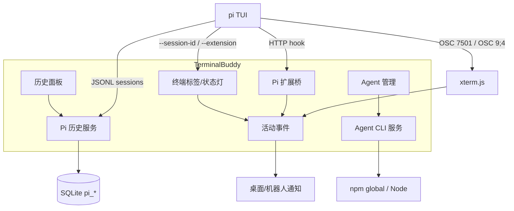

# Pi Agent 全面支持实施计划

制定日期：2026-10-26。对应调研：[Pi Agent 支持调研](./Pi%20Agent%20支持调研.md)。

目标版本：TerminalBuddy 1.9.x 完成 P0/P1（TUI 一等公民），P2/P3 视产品决策进入后续版本。

实施范围：桌面端、完整 Web UI、Docker/Linux、Windows 桌面；手机 SPA 与 Android 原生客户端放到 P3。

> 本计划只描述实施步骤，不包含代码改动。任务中的文件路径均相对仓库根目录。

---

## 0. 计划摘要

| 里程碑 | 目标 | 交付物 | 估算 |
| --- | --- | --- | --- |
| M0 | 地基与兼容性 | provider 类型、设置字段、绑定模型、测试夹具 | 1–2 人日 |
| M1 / P0 | 能装、能启动、能发现 | Agent 管理、npm 安装/更新、Docker Node、命令模板 | 4–7 人日 |
| M2 / P1a | Pi 历史后端 | JSONL 解析器、SQLite 索引、搜索/回放/导出/删除 | 6–9 人日 |
| M3 / P1a | Pi 历史前端 | 历史标签页、回放页、Pi 恢复入口 | 5–6 人日 |
| M4 / P1b | 精确绑定、恢复与模型启动 | `--session-id` 注入、任务摘要、通用会话登记、页签恢复、Codex 恢复、Pi 模型菜单、项目 Pi 开关 | 13–17 人日 |
| M5 / P1c | 状态、通知、扩展桥 | Pi 扩展、Hook 端点、OSC 7501、指示灯、通知、工具确认 | 7–11 人日 |
| M6 / P2 | 配置面板 | Pi 面板、settings/models/auth/MCP/packages | 10–14 人日 |
| M7 / P3 | 原生 AI 与移动端 | RPC 客户端、原生会话、Android/手机 SPA | 25–40 人日 |

**建议首个可发布版本只承诺 P0 + P1**：用户能安装 Pi、从项目启动、看到历史、恢复会话、看到任务摘要/状态灯/通知。P2/P3 作为后续增强，避免首个版本范围失控。

**建议排期（单开发者，含评审/回归缓冲）：**

- 第 1–2 周：M0 + M1（P0）
- 第 2–4 周：M2（历史后端）
- 第 4–5 周：M3（历史前端）
- 第 5–8 周：M4（绑定/摘要/恢复/模型菜单）
- 第 8–10 周：M5（扩展/状态/通知/工具确认）
- 第 11 周：Windows/Docker/Web 回归 + 发布 1.9.0
- 第 12–14 周：M6（P2）
- 第 15–20 周：M7（P3，可选）

若有两名后端/一名前端，可把 M2/M4 与 M3/M5 并行，P0–P1 压缩到约 5–6 周。

---

## 1. 范围与不在范围

### 1.1 本计划范围（P0–P1）

- Pi 1.4.0+ 的检测、安装、版本、更新、基础启动命令。
- Pi 终端启动（项目/连接/空白终端）。
- Pi 会话历史：扫描、索引、列表、搜索、回放、重命名、收藏、归档、删除、导出。
- Pi 历史会话恢复：`pi --session <path|id>`。
- 会话精确绑定、任务摘要、页签恢复。
- Pi 活动状态、桌面/机器人通知、工具确认（本期实现，默认关闭，可在 Pi 设置开启）。
- Pi 模型菜单：指定 provider/model/thinking 启动、历史恢复指定模型、标签 chip。
- Pi 扩展桥（精确会话绑定/事件上报）。
- Codex 容器重启恢复（复用通用会话登记/恢复链路）。
- Docker 运行镜像补 Node；Windows Node/Git Bash 预检。
- README/README_zh、CHANGELOG、使用指南、API 文档更新。

### 1.2 不在本计划范围（P2/P3 或明确不做）

- Pi 配置面板、Pi packages 管理（P2）。
- 基于 Pi RPC 的原生 AI 会话（P3）。
- 手机 SPA/Android 的 Pi 支持（P3；手机 SPA 已解冻）。
- 远程 SSH 中的 Pi 深度集成（Hook/历史只承诺本地/Docker）。
- xterm.js 内联图片协议（kitty/iTerm2）渲染。
- Pi 的 `/share`、遥测、Coder/OpenClaw 等外部生态。
- 修改 Pi 源码或 Pi session 文件内容。

### 1.3 明确不做的事

- 不解析终端屏幕来猜 Pi 的会话 ID/状态（用扩展事件/OSC 7501/会话文件）。
- 不把 TerminalBuddy 的 Claude/Codex 供应商表强行映射成 Pi 的 provider。
- 不自动安装宿主 Node（Docker 镜像内预装；桌面只提示用户安装）。
- 不默认开启 Pi 工具确认（本期实现审批链路，但默认关闭，避免改变 Pi 的全权限默认行为）。
- 默认 Pi 基础命令使用 `pi --approve`（信任已登记项目的本地配置/资源）；用户可在 Agent 管理改为 `pi` 关闭。
- 手机 SPA 已解冻，允许为 Pi 修改 `web/`；Pi 相关改动排 P3，P0–P1 不改。

---

## 2. 目标与验收标准

### 2.1 P0 验收

- Agent 管理页出现 Pi 卡片，显示检测状态/版本/可更新状态。
- Docker 镜像内可一键安装 Pi；`pi --version` 返回 1.4.0（或目标版本）。
- Windows 在 Node ≥ 22.19、npm 可用时可安装/更新；缺 Node 时给出明确错误和安装指引，不静默失败。
- 命令模板/建议中出现 `pi`；项目可用 `pi` 启动；默认基础命令为 `pi --approve`，可在 Agent 管理覆盖。
- 现有 Claude/Codex 的检测、安装、设置、启动不回归。
- `npx tsc --noEmit`、`cargo check`、`cargo test --lib`、`python scripts/check-invoke-coverage.py` 通过。

### 2.2 P1 验收

- Claude 历史标签始终显示；检测到 Codex 已安装时显示 Codex 标签，检测到 Pi 已安装时显示 Pi 标签；未安装的 Agent 不显示对应标签。
- 搜索能命中 user/assistant/tool 文本；回放按活动分支展示，不展示废弃分支。
- 重命名/收藏/归档/删除/导出可用；删除只移动文件，不改写 Pi 会话。
- 历史恢复能打开 `pi --session <path>`；同目录多会话不串。
- Pi 模型菜单可用：项目/历史右键选择 provider/model/thinking，启动与恢复带 `--provider`/`--model`/`--thinking`，标签显示模型 chip。
- 终端任务摘要显示 Pi 会话标题/模型；页签/会话树/Web 页签同步。
- 容器重启后，已绑定 Pi 会话的页签可自动恢复；Codex 页签同样接入通用恢复链路。
- 运行 Pi 时标签指示灯/通知可用：working、blocked、done、error。
- Pi 工具确认本期可用（默认关闭，可在 Pi 设置开启）；开启后 `bash/edit/write` 可在手机/桌面允许或拒绝，关闭时保持 Pi 原生行为。
- Pi 扩展可选安装；未安装时退回 OSC 7501/目录扫描，核心功能仍可用。
- Claude 的通知/决策/恢复不回归；Codex 历史恢复/重启恢复不回归。

### 2.3 质量门禁

每个里程碑结束必须执行：

```bash
cd terminal-buddy
npx tsc --noEmit

cd src-tauri
cargo check
cargo test --lib

cd ..
python scripts/check-invoke-coverage.py
```

新增/删除 Tauri 命令时必须更新 `invoke_handler![]`、`commands/mod.rs`、前端 `services/tauri/*`，并通过覆盖脚本。

---

## 3. 技术方案基线

### 3.1 Pi 集成接口（摘要）

- **会话**：`~/.pi/agent/sessions/--<cwd>--/<timestamp>_<id>.jsonl`，v3 树形 JSONL。
- **会话 ID**：UUIDv7；`--session-id <id>` 可在新会话启动时预生成。
- **扩展**：`session_start`、`input`、`agent_settled`、`tool_call`、`session_shutdown`；`ctx.sessionManager` 可读 session ID/file。
- **终端**：OSC 0 标题、OSC 7501 状态、OSC 9;4 进度、OSC 52 剪贴板。
- **CLI**：`--session <path|id>`、`--session-id`、`--extension`、`--provider`、`--model`、`--thinking`、`--tui-mode`。
- **RPC**：`pi --mode rpc`，严格 JSONL；P3 使用。

详细协议见调研文档。

### 3.2 关键设计决策

| 决策 | 选择 | 理由 |
| --- | --- | --- |
| 安装方式 | Docker/桌面优先 npm 全局安装到用户可写前缀 | 官方安装器无 `--yes`，无 TTY 时会等待/失败；npm 可后台执行 |
| Docker Node | 运行镜像预装 Node 24 | Pi 硬性要求 ≥ 22.19；镜像内安装最稳定，不污染宿主 |
| Windows Git Bash | 只检测/提示，不自动安装 | 避免宿主环境改动；大部分 Git 用户已具备 |
| 会话绑定 | `--session-id` 注入 + Pi 扩展上报 + 目录扫描兜底 | 精确绑定优先，兼容手动启动 |
| 历史删除 | 移动到 TerminalBuddy 回收目录 | 不破坏 Pi 自己的 resume/状态 |
| 自定义标题 | 存 TerminalBuddy SQLite | 不写入 Pi session，避免锁/格式风险 |
| 模型来源 | Pi 自己的 `--list-models`/RPC | 不复制 Pi 的 provider/auth 体系 |
| 状态/通知 | OSC 7501 兜底 + Pi 扩展事件 | 扩展精确，OSC 覆盖手动启动 |
| 项目信任 | 默认 Pi 基础命令 `pi --approve` | 项目已在 TerminalBuddy 登记；减少首次启动信任提示；可在 Agent 管理改回 `pi` |
| 工具确认 | 本期实现、默认关闭 | 保留 Pi 原生全权限行为；需要时在 Pi 设置开启审查 `bash/edit/write` |
| 手机端 | P3；手机 SPA 已解冻 | `web/` 可改，Android 只做原生 AI；工作量大 |

### 3.3 数据模型变更

#### `AgentCommands`

```json
{
  "claude": "",
  "codex": "",
  "pi": ""
}
```

- Rust：`AgentCommands` 增加 `#[serde(default)] pub pi: String`。
- TS：`AgentCommands` 增加 `pi: string`。
- 保存命令：`save_agent_commands(claude, codex, pi: Option<String>)`，旧客户端只传两个参数时 `pi` 为空。
- 空串回退内置 `pi`。

#### `EnabledAgents`

```json
{ "claude": true, "codex": true, "pi": true }
```

- Rust/TS 都加 `pi`，`#[serde(default = "default_true")]`。
- 旧 `projects.json` 没有 `pi` 时默认启用，避免旧项目菜单缺项。

#### 会话绑定

新增统一绑定结构，避免为每个 Agent 增加一个 `xxxSessionId`：

```ts
interface AgentSessionBinding {
  provider: 'claude' | 'codex' | 'pi';
  sessionId: string;
  sessionFile?: string;
  cwd?: string;
}
```

- 前端 store：`agentSessionBindings: Record<terminalId, AgentSessionBinding>`。
- 兼容旧 `claudeSessionIds`：首次加载时迁移为 `claude` 绑定；保留一个只读派生函数给旧组件。
- 服务端登记表：`agent_session_registry.json`，schema 见 3.4。
- `SavedTab` 增加 `agentSession?: AgentSessionBinding`。

#### 活动状态

短期增量方案（降低回归风险）：

```ts
type TerminalRuntimeKind = 'shell' | 'claude' | 'pi';
interface TerminalActivityState {
  runtimeKind: TerminalRuntimeKind;
  provider?: 'claude' | 'codex' | 'pi';
  phase: 'idle' | 'running' | 'attention' | 'completed' | 'failed';
  ...
}
```

- `getIndicatorLight` 从 `runtimeKind !== 'claude'` 改为 `runtimeKind !== 'shell'`。
- 文案按 `provider` 动态显示；没有 provider 的旧 Claude 事件默认 `claude`。
- 后续如需再泛化为 `'agent'`，另行重构；P1 不为此扩大范围。

#### 历史 provider

```ts
type SessionHistoryProvider = 'claude' | 'codex' | 'pi';
```

- `TerminalTaskSummary.provider` 同步加 `'pi'`。
- `SessionTaskLabel`、`TabNav.css` 增加 Pi 配色/名称。
- `HistoryPanel` 标签页数组改为 `['claude','codex','pi']`，键盘左右切换用索引，不再写死二元。

### 3.4 服务端会话登记表

新文件：`<dataDir>/agent_session_registry.json`

```json
{
  "version": 2,
  "sessions": {
    "<terminalId>": {
      "provider": "pi",
      "sessionId": "019...",
      "sessionFile": "/home/user/.pi/agent/sessions/--workspace--/2026-...jsonl",
      "cwd": "/workspace",
      "updatedAt": 1760000000000
    }
  }
}
```

迁移：

- 启动时读取旧 `claude_session_registry.json`，转换为 `provider: "claude"` 的记录；保留旧文件一个版本周期，不删除。
- 记录保留 7 天；存活会话每小时刷新；上限 500 条；ID 校验沿用现有 `is_valid_session_id`（允许 UUID/十六进制/连字符）。
- 新命令：`get_agent_sessions_for_terminals(ids)`；旧 `get_claude_sessions_for_terminals` 保留并内部调新实现。

### 3.5 API 契约

#### Agent 管理

- `GET /api/container/environment` 返回 `{ claude, codex, pi }`。
- `GET /api/container/environment/pi`、`POST /api/container/environment/pi/install`、`POST /api/container/environment/pi/update`。
- Tauri 命令保持不变，`get_agent_cli_environment` 返回 `pi` 字段；`parse_tool` 支持 `"pi"`。
- `GET /api/runtime` 的 `agentCommands` 增加 `pi`。

#### Pi 历史

桌面 Tauri：

- `pi_history_rescan`
- `pi_history_list`
- `pi_history_search`
- `pi_history_get_replay`
- `pi_history_rename`
- `pi_history_set_flags`
- `pi_history_delete`
- `pi_history_delete_many`
- `pi_history_export`

完整 Web UI 通过 `desktop_dispatch` 调用同名命令；如手机 SPA 后续需要，再加 REST：

- `GET /api/pi-history`
- `GET /api/pi-history/search`
- `POST /api/pi-history/rescan`
- `GET /api/pi-history/{id}/replay`
- `POST /api/pi-history/{id}/rename`
- `POST /api/pi-history/{id}/flags`
- `DELETE /api/pi-history/{id}`
- `POST /api/pi-history/delete-batch`
- `GET /api/pi-history/{id}/export`

#### Pi Hook

`POST /api/pi/hooks`（或复用 `/api/claude/hooks` 增加 `provider` 分支；见 M5 决策）：

```json
{
  "sessionId": "019...",
  "sessionFile": "/home/...jsonl",
  "event": "SessionStart | UserPromptSubmit | Stop | StopFailure | SessionEnd | ToolCall",
  "prompt": "可选",
  "toolName": "可选",
  "toolInput": {},
  "lastAssistantMessage": "可选",
  "reason": "可选"
}
```

鉴权沿用现有终端 token：

```http
Authorization: Bearer <TERMINAL_BUDDY_HOOK_TOKEN>
X-TerminalBuddy-Terminal-Id: <terminalId>
```

#### Pi 模型（P1）

- `get_pi_models`（读取 `pi --list-models`/RPC，供模型菜单）

#### Pi 配置（P2）

- `get_pi_config_state`
- `save_pi_settings`
- `save_pi_models`
- `check_pi_auth`
- `pi_packages_list/install/remove/update`
- `pi_mcp_list/add/remove/login/logout`

---

## 4. 架构与依赖



依赖关系：

```text
M0 地基
 ├─ M1 P0 安装/启动
 ├─ M2 P1a 历史后端 ── M3 P1a 历史前端
 ├─ M4 P1b 绑定/摘要/恢复
 └─ M5 P1c 扩展/状态/通知
        M3 ── M5（UI 状态）
        M2 ── M4（摘要解析）
M6 P2 依赖 M1/M4/M5
M7 P3 依赖 M4/M5/M6
```

并行建议：

- 后端 A：M1 → M2 → M4。
- 后端 B：M5 扩展/Hook（与 M2/M4 可并行，但需先定 M0 的 binding/API 契约）。
- 前端：M3 历史 UI 可在 M2 的解析器接口冻结后开工；M5 状态灯/通知 UI 可与 M3 并行。
- QA：每个里程碑结束跑 Windows/Docker/完整 Web 三套手工矩阵。

---

## 5. 详细工作分解

### M0：地基与兼容性（1–2 人日）

| ID | 任务 | 主要文件 | 依赖 | 验收 | 估算 |
| --- | --- | --- | --- | --- | --- |
| M0-01 | 增加 `AgentId = 'claude' \| 'codex' \| 'pi'` 的 Rust/TS 类型与常量；统一 display name/颜色 | `src-tauri/src/services/agent_cli_service.rs`、`src/services/tauri/agentCli.ts`、`src/types/index.ts` | 无 | 类型编译通过；旧值不变 | 0.5d |
| M0-02 | `AgentCommands`、`EnabledAgents` 增加 `pi`，serde 默认值兼容旧 JSON | `src-tauri/src/models/settings.rs`、`src-tauri/src/commands/profile.rs`、`src/services/tauri/settings.ts`、`src/types/index.ts` | M0-01 | 读取旧 settings/projects 不报错；新字段默认空/true | 0.5d |
| M0-03 | 定义 `AgentSessionBinding`，确定前端 store/服务端 registry/`SavedTab` 的兼容迁移方案 | `src/stores/appStore.ts`、`src/services/sessionRestore.ts`、`src-tauri/src/services/claude_session_registry_service.rs` | M0-01 | 设计评审通过；旧 `claudeSessionIds` 可继续读 | 0.5d |
| M0-04 | 建立 Pi 测试夹具与 feature detect helper：版本、help 签名、session header 样例 | `src-tauri/src/services/pi_*`、`src-tauri/tests/fixtures/pi/` | M0-01 | 夹具覆盖 v1/v2/v3、分支、压缩、损坏文件 | 0.5d |

### M1 / P0：Agent 管理与运行环境（3–5 人日）

| ID | 任务 | 主要文件 | 依赖 | 验收 | 估算 |
| --- | --- | --- | --- | --- | --- |
| M1-01 | `CliTool::Pi` + `Environment.pi` + `binary/name/package/preview_tags` | `src-tauri/src/services/agent_cli_service.rs` | M0 | 后端编译；Claude/Codex 测试不回归 | 0.5d |
| M1-02 | Pi 版本检测：`pi --version` 裸 semver；路径候选（PATH、`~/.local/bin`、`~/.pi/agent/bin`、Windows shim）；`pi --help` 签名校验 | `agent_cli_service.rs` | M1-01 | 单元测试：正确版本、错误输出、同名假二进制被拒绝 | 0.5d |
| M1-03 | Pi 安装/更新：Node/npm 预检、`NPM_CONFIG_PREFIX`、`npm install -g --ignore-scripts @earendil-works/pi-coding-agent[@version]`、日志/超时/校验 | `agent_cli_service.rs` | M1-02 | Docker 安装成功；缺 Node 返回明确错误；更新后版本校验 | 1d |
| M1-04 | Tauri `parse_tool("pi")`、REST `CliToolParam::Pi`、`desktop_dispatch`/`desktop_handler` 同步 | `src-tauri/src/commands/agent_cli.rs`、`src-tauri/src/web/handlers/container_environment.rs`、`desktop_dispatch.rs`、`desktop_handler.rs` | M1-01 | 桌面/浏览器 API 均能查/装/更 Pi | 0.5d |
| M1-05 | 前端 Agent 管理：`AgentCli` 加 `pi`、工具卡、状态 Record、保存命令三参数 | `src/services/tauri/agentCli.ts`、`src/services/browser/containerEnvironment.ts`、`src/services/agentCli.ts`、`src/components/settings/AgentManagementSettings.tsx` | M1-04 | UI 三张卡片；安装/更新/命令保存正常 | 1d |
| M1-06 | `agentCommands.pi` 全链路：store slice、`agentCommands.ts`、`App.tsx`、`WebEntry`、`desktop_handler` | `src/stores/slices/claudeLaunchSlice.ts`、`src/utils/agentCommands.ts`、`src/App.tsx`、`src/components/browser/WebEntry.tsx` | M0-02 | 桌面/浏览器启动命令可用；旧两字段兼容 | 0.5d |
| M1-07 | 命令模板/建议加入 Pi；新增 `DEFAULT_PI_COMMAND='pi --approve'`（默认信任已登记项目） | `src/data/commandTemplates.ts`、`src/utils/piLaunch.ts`、`src/utils/agentCommands.ts` | M1-06 | 终端输入 `pi` 有建议；模板可见；默认命令含 `--approve` | 0.5d |
| M1-08 | Docker 运行镜像补 Node 24；npm 前缀指向 `~/.local`；验证 Pi 安装/运行 | `Dockerfile`、`README.md`、`README_zh.md`、`DEPLOY_README.md` | M1-03 | Docker 内 `pi --version` 成功；镜像可构建 | 1d |
| M1-09 | Windows 预检：Node ≥ 22.19、npm、Git Bash；错误提示与安装指引；启动终端 PATH 注入 npm prefix | `agent_cli_service.rs`、`src-tauri/src/commands/terminal.rs` | M1-03 | 有/无 Node 两条路径均按预期；Git Bash 缺失提示 | 1d |
| M1-10 | 文档/测试：Agent 管理说明、Pi 安装要求、CHANGELOG；补 Rust 单测与覆盖脚本 | `README.md`、`README_zh.md`、`CHANGELOG.md`、`scripts/check-invoke-coverage.py` | M1-01~09 | 全部门禁通过 | 0.5d |

**P0 风险控制：**

- 不把官方 install.sh/ps1 作为唯一安装路径；npm 失败时给出官方脚本/Node 安装链接。
- Docker 镜像改动先做独立构建验证，避免影响现有 `update.sh`/`quick-update.sh`。
- 前端 `Record<AgentCli, ...>` 的每个初始化点都要补 `pi`，否则运行时报 `undefined`；用 TypeScript 编译捕获。

### M2 / P1a：Pi 历史后端（5–7 人日）

| ID | 任务 | 主要文件 | 依赖 | 验收 | 估算 |
| --- | --- | --- | --- | --- | --- |
| M2-01 | `pi_transcript`：header/entry 读取、v1/v2/v3、未知 entry 跳过、流式 BufReader | 新 `src-tauri/src/services/pi_transcript.rs` | M0-04 | 夹具测试全过；损坏行不 panic | 1d |
| M2-02 | 活动分支重建：`parentId` 回溯、compaction/branch_summary/context_edit、leaf 规则 | `pi_transcript.rs` | M2-01 | 分支夹具只返回活动分支；压缩/编辑场景正确 | 1d |
| M2-03 | 标题/模型/Token/消息计数提取；跳过 system/图片/超长内容 | `pi_transcript.rs` | M2-01 | 与 `pi` 的 `/session` 近似一致；大文件有上限 | 1d |
| M2-04 | SQLite schema + migration `pi-history-v1`；analyzer_version | `src-tauri/src/services/pi_history_service.rs`、`database_service.rs` | M2-01 | 老库自动建表；重复启动幂等 | 0.5d |
| M2-05 | 扫描/索引：session 根解析（env/settings/default）、mtime/size 增量、批量提交、后台 emit `pi-history-indexed` | `pi_history_service.rs` | M2-04 | 1000 个夹具会话扫描 < 5s；增量 < 500ms | 1d |
| M2-06 | `list_sessions` / `search`：project_dir 过滤、LIKE 转义、snippet、归档 | `pi_history_service.rs` | M2-05 | 中文/百分号/下划线搜索正确 | 0.5d |
| M2-07 | `get_replay` / `export_session`：Markdown + JSONL；工具摘要 | `pi_history_service.rs` | M2-02 | 回放分页、导出内容完整 | 1d |
| M2-08 | `rename/set_flags/delete/delete_many`：自定义标题、标记、回收目录、活动会话保护 | `pi_history_service.rs` | M2-04 | 删除可恢复；运行中会话拒绝删除 | 0.5d |
| M2-09 | Tauri 命令 + `commands/mod.rs` + `lib.rs` + `desktop_dispatch` + 可选 REST | `src-tauri/src/commands/pi_history.rs`、`web/handlers/pi_history_handler.rs`、`web/server.rs` | M2-05~08 | invoke coverage 通过；Web 完整界面可调用 | 1d |
| M2-10 | 测试/性能：夹具、迁移、搜索、删除、导出、并发扫描 | `pi_transcript.rs`、`pi_history_service.rs` | M2-01~09 | `cargo test --lib` 全过 | 1d |

**解析器实现约定：**

- 只读文件；不调用 `pi` 进程做历史扫描。
- 每行单独 `serde_json::from_str`；失败行记录 debug 日志后跳过，不中断整个文件。
- `message.content` 兼容 string / array；数组内 `text`/`thinking`/`toolCall`/`image` 分别处理。
- `session_info.name` 取最新一条；`custom_title` 优先。
- `usage` 汇总 assistant message 的 `usage`，可加 `usage` entry；避免重复计入。
- `toolResult` 计入消息列表时显示工具名/结果摘要；`bashExecution` 视为工具。
- `compaction`/`branch_summary` 作为系统摘要消息展示，不参与普通搜索标题。
- `context_edit` 不改变回放原文；如需显示“已编辑”标记，P2 再做。
- 文件大小/消息长度上限：单条内容截断（如 64KB），图片不落库。

### M3 / P1a：Pi 历史前端（4–5 人日）

| ID | 任务 | 主要文件 | 依赖 | 验收 | 估算 |
| --- | --- | --- | --- | --- | --- |
| M3-01 | 类型/API 包装：`SessionHistoryProvider` 加 `pi`、`PiSessionItem`、`piHistory.ts` | `src/types/index.ts`、`src/services/tauri/piHistory.ts`、`src/services/tauri/index.ts` | M2-09 | tsc 通过 | 0.5d |
| M3-02 | `sessionHistory.ts` 增加 pi provider：label/home/indexedEvent/list/rescan/search/replay/rename/flags/delete/export/resume | `src/services/sessionHistory.ts` | M3-01 | 历史面板调用链完整 | 0.5d |
| M3-03 | `HistoryPanel` 按需显示来源标签：Claude 始终显示；Codex/Pi 仅在检测到已安装时显示；已安装但无会话时显示空状态；被卸载/检测失败时隐藏并回退到 Claude | `src/components/claude-history/HistoryPanel.tsx`、`HistoryPanel.css`、`src/services/agentCli.ts` | M3-02 | 未装 Codex/Pi 时只显示 Claude；安装后出现对应标签；卸载后隐藏且不留在空 tab | 1.5d |
| M3-03b | Codex/Pi 安装状态缓存/刷新：Panel 激活时并行重查 `getAgentCli('codex'/'pi')`；Agent 管理安装/更新完成后广播状态变更；安装中显示加载态 | `src/components/claude-history/HistoryPanel.tsx`、`src/components/settings/AgentManagementSettings.tsx`、`src/stores/appStore.ts` | M3-03 | 安装完成无需刷新页面即可出现对应标签 | 0.5d |
| M3-04 | `ReplayPage`/`ClaudeExportDialog` 支持 pi 名称与导出 | `src/components/claude-history/ReplayPage.tsx`、`ClaudeExportDialog.tsx` | M3-02 | 回放/导出正常 | 0.5d |
| M3-05 | `resumePiSession.ts`：选择 Profile、`pi --session <path>`、指定模型预留、空白终端回退 | `src/components/claude-history/resumePiSession.ts`、`src/utils/piLaunch.ts` | M3-02 | 历史右键恢复成功；同目录多会话正确 | 1d |
| M3-06 | 任务摘要类型/标签：`provider: 'pi'`、Pi 名称/颜色、`SessionTaskLabel`/`TabNav.css` | `src/stores/taskSummaryStore.ts`、`src/components/shell/SessionTaskLabel.tsx`、`src/components/shell/TabNav.css` | M3-01 | 任务摘要显示 Pi/模型 | 0.5d |
| M3-07 | 手动回归 + tsc：列表/搜索/回放/重命名/收藏/删除/导出/恢复；未装 Codex/Pi 时只显示 Claude、安装后出现对应标签、卸载后回退 | 无新增文件 | M3-03~06 | 验收清单全过 | 1d |

### M4 / P1b：精确绑定、任务摘要、页签恢复与模型菜单（13–17 人日）

| ID | 任务 | 主要文件 | 依赖 | 验收 | 估算 |
| --- | --- | --- | --- | --- | --- |
| M4-01 | `terminal_task_service` 增加 Pi 根目录（`PI_CODING_AGENT_DIR`/`PI_CODING_AGENT_SESSION_DIR`/settings） | `src-tauri/src/services/terminal_task_service.rs` | M0-03 | 能定位默认/自定义 Pi 会话目录 | 0.5d |
| M4-02 | `prepare_launch` 检测 pi 命令；无会话选择时注入 `--session-id <uuid>`；记录 `provider/sessionId` | `terminal_task_service.rs`、`src-tauri/src/commands/terminal.rs` | M4-01 | 新启动 Pi 立即绑定；`-c/-r/--session` 不注入 | 1.5d |
| M4-03 | 通用 `record_agent_session(terminal, provider, sessionId, file?)`；Hook/扩展/进程扫描共用 | `terminal_task_service.rs`、`claude_hook_handler.rs` | M4-01 | Claude 现有调用不回归；Pi 可写入 | 0.5d |
| M4-04 | Pi transcript 摘要：标题、模型、Token；`find_transcript` 支持 `_<id>.jsonl` | `terminal_task_service.rs`、`pi_transcript.rs` | M2-03 | 任务摘要显示 Pi 标题/模型 | 1d |
| M4-05 | 前端通用绑定 store：`agentSessionBindings`、旧 `claudeSessionIds` 迁移、Pi 读写 | `src/stores/appStore.ts`、`src/stores/slices/sessionsSlice.ts`、`src/App.tsx` | M0-03 | 旧标签仍能恢复；Pi 绑定持久化 | 1d |
| M4-06 | 服务端 registry 泛化：新文件/schema、旧文件迁移、命令别名 | `src-tauri/src/services/claude_session_registry_service.rs`（或新 `agent_session_registry_service.rs`）、`commands/claude_session.rs` | M4-03 | 旧 Claude 记录可读；Pi 记录可回查 | 1d |
| M4-07 | `sessionRestore` 泛化：`AgentSessionBinding`、剥离 `--resume`/`resume`/`--session`、按 provider 拼恢复命令 | `src/services/sessionRestore.ts`、`src/utils/commandParams.ts`、`src/utils/piLaunch.ts` | M4-05/06 | Pi 页签重启恢复；Claude 不回归；Codex 由 M4-10 接入 | 1.5d |
| M4-08 | 测试：多会话同 cwd、手动 `pi`、`-c/-r`、扩展缺失、容器重启、Codex 恢复、模型菜单 | 单测 + 手工 | M4-02~07、M4-09、M4-10、M4-11/12、M4-13 | 验收清单全过 | 1d |
| M4-09 | 目录扫描兜底：按 cwd/启动时间找唯一 Pi session；多候选不猜；Windows 标注依赖扩展/注入 | `terminal_task_service.rs`、`terminal_task_process.rs` | M4-01 | 手动 `pi` 单会话可绑定；多会话不串 | 1d |
| M4-10 | Codex 页签重启恢复：Codex 会话绑定接入通用 registry/sessionRestore；`codex resume` 重建 | `terminal_task_service.rs`、`src/services/sessionRestore.ts`、`src/utils/codexLaunch.ts` | M4-07 | Codex 页签容器重启后可续接；Claude/Pi 不回归 | 1.5d |
| M4-11 | Pi 模型目录：`get_pi_models` 调用 `pi --list-models` 解析 provider/model，或 RPC `get_available_models`；缓存/超时/未登录提示 | `src-tauri/src/services/pi_model_service.rs`、`commands/pi_model.rs` | M1-07 | 能返回 provider 分组模型；未安装/未登录有明确提示 | 1.5d |
| M4-12 | Pi 模型菜单：`__TB_PI_REF__`、`piLaunch.ts`、`PiModelMenuSection`、项目/历史右键菜单、冲突参数剥离、恢复指定模型、标签 chip | `src/utils/piLaunch.ts`、`src/components/shared/ClaudeModelMenuSection.tsx`、`src/components/profile-config/ConfigNav.tsx`、`src/components/claude-history/HistoryPanel.tsx` | M4-11、M4-07 | 项目/历史右键可选 Pi 模型；标签 chip 正确 | 2.5d |
| M4-13 | 项目级 `enabledAgents.pi` + 项目编辑 UI + `projectModelSources`（模型菜单依赖） | `commands/profile.rs`、`src/types/index.ts`、`ProjectEditorDialog`/`ConfigNav` | M0-02、M4-12 | 旧项目默认启用；可关闭 Pi；项目模型菜单按开关显示 | 1d |

**绑定优先级（实现必须按此顺序）：**

1. Pi 扩展 `session_start` 上报（最精确，覆盖手动/恢复/自定义目录）。
2. `prepare_launch` 注入 `--session-id`（覆盖 TerminalBuddy 启动的新会话）。
3. 目录扫描（启动后唯一候选才绑定；多候选不猜）。
4. 无法绑定时只显示终端名称，不显示错误摘要。

**命令注入约束：**

- 只处理本地 shell 类型（`cmd/powershell/pwsh/bash/sh/zsh`）。
- 只处理“命令首个可执行 token 是 `pi`”的简单形式；遇到 `&&`/`;`/`|`/管道/脚本包装时跳过注入，交给扩展/扫描。
- 若命令已含 `--session`、`--session-id`、`-c`、`--continue`、`-r`、`--resume`、`--fork`、`--no-session`，不注入。
- 引号/空格遵循现有 `codex_executable_end`/`shell_words` 的保守策略；注入失败不影响原命令执行。

### M5 / P1c：Pi 扩展桥、状态、通知与工具确认（7–11 人日）

| ID | 任务 | 主要文件 | 依赖 | 验收 | 估算 |
| --- | --- | --- | --- | --- | --- |
| M5-01 | Pi 扩展脚本：无 env 时 no-op；`session_start`/`input`/`agent_settled`/`session_shutdown` 上报；`tool_call` 心跳 | 新 `src-tauri/resources/pi/terminal-buddy-extension.js` | M0-03 | 手工 `pi` 启动能上报；未装 TerminalBuddy 环境不报错 | 1d |
| M5-02 | 扩展安装器/状态：全局 `~/.pi/agent/extensions/terminal-buddy.js` 或启动 `--extension <dataDir>/PiAgent/...`；安装/卸载/校验 | 新 `src-tauri/src/services/pi_extension_service.rs`、`commands/pi_extension.rs`、设置项 | M5-01 | 安装/卸载幂等；不覆盖未知文件 | 1d |
| M5-03 | Hook 端点：`/api/pi/hooks`（或 Claude Hook 增加 provider 分支）；token/terminal 校验；事件解析 | `src-tauri/src/web/handlers/pi_hook_handler.rs`、`web/claude_hook_server.rs`、`services/pi_hook_service.rs` | M4-03 | 无效 token 401；SessionStart/Stop 等事件落库/发事件 | 1d |
| M5-04 | 活动状态模型：`runtimeKind='pi'`、`provider`、指示灯文案/颜色、过期/清除 | `src/stores/appStore.ts`、`sessionsSlice.ts`、`src/utils/claudeIndicator.ts`、`src/services/claudeNotification.ts` | M5-03 | Pi working/done/error 灯正确；Claude 不回归 | 1d |
| M5-05 | OSC 7501 解析：注册 handler、base64 msg、state/kind 映射、无扩展兜底 | `src/components/terminal/TerminalInstance.tsx`、新 `src/utils/terminalOsc.ts` | M5-04 | 手动 `pi` 也显示状态；`blocked` 显示等待确认 | 1d |
| M5-06 | 终端 env 调优：`PI_PROGRAM_STATUS=1`、`PI_CLIPBOARD_OSC52=1`、`PI_TRUE_COLOR=1`、`PI_HYPERLINKS=1`、`PI_IMAGE_PROTOCOL=none` | `src-tauri/src/commands/terminal.rs` | M5-05 | Pi 状态稳定；Web 复制可用；无图片乱码 | 0.5d |
| M5-07 | 通用通知：`agentNotification.ts` 支持 provider；桌面/机器人标题动态；完成/失败/等待确认 | `src/services/claudeNotification.ts`（或新 `agentNotification.ts`）、`commands/notification.rs`、`web/handlers/bot*` | M5-04 | Pi 完成/失败通知；Claude 不回归 | 1d |
| M5-08 | 工具确认本期实现：Pi 扩展 `tool_call` → 决策卡；覆盖 `bash/edit/write`；默认关闭，设置中开启；超时/失败放行 | `terminal-buddy-extension.js`、`pi_hook_handler.rs`、`ClaudeDecisionDialog` 泛化、Pi 设置 | M5-03/07 | 开启后手机/桌面可允许或拒绝；关闭时行为不变 | 2d |
| M5-09 | 标签/会话树/Web 状态展示：Pi 名称、颜色、进度（OSC 9;4 可选） | `SessionTaskLabel.tsx`、`TabNav.css`、`TerminalTabBar.tsx`、完整 Web UI（`src`） | M5-04 | 三端显示一致 | 1d |
| M5-10 | 测试：扩展映射脚本、Hook 单测、无扩展/有扩展、Windows/Docker | `scripts/test-pi-extension.mjs`、Rust 单测 | M5-01~09 | 验收清单全过 | 1d |

**扩展事件映射：**

| Pi 事件/OSC | TerminalBuddy phase | 通知 | 备注 |
| --- | --- | --- | --- |
| `session_start` | `idle`（presence） | 无 | 绑定 session ID/file |
| `input` | `running` | 无 | 记录任务标题 |
| `tool_call` | `running` 心跳 | 无 | 工具确认（可开关） |
| `agent_settled`（正常） | `completed` | 完成 | 最终空闲信号 |
| `agent_settled`（error/aborted） | `failed` / `idle` | 失败 | 看 stopReason |
| `session_shutdown` | `idle`/结束 | 无 | 清理绑定 |
| OSC 7501 `blocked` | `attention` | 等待确认 | permission/question/auth |
| OSC 7501 `error` | `failed` | 失败 | 无扩展也可用 |
| OSC 9;4 | 进度 | 无 | 可选标签进度 |

**安全约束：**

- 扩展安装必须用户显式确认；安装文件写前校验目标不存在或属于 TerminalBuddy。
- 扩展无 env 时完全 no-op；不得在 factory 中启动进程/定时器（遵循 Pi 扩展规范）。
- Hook token 不写日志；审批超时默认放行，避免卡死 Pi。
- 审批默认关闭；开启时 UI 明确提示“将改变 Pi 的默认全权限行为”。

### M6 / P2：Pi 配置面板（10–14 人日）

| ID | 任务 | 主要文件 | 依赖 | 验收 | 估算 |
| --- | --- | --- | --- | --- | --- |
| M6-01 | `pi_config_service`：路径解析、JSON 读取/校验/原子写/备份、auth 状态 | 新 `src-tauri/src/services/pi_config_service.rs` | M1 | settings/models 读写安全；损坏文件不覆盖 | 1.5d |
| M6-02 | 设置/模型编辑 UI：settings.json 表单+JSON、models.json Schema 校验、`pi --list-models` 查看 | `src/components/pi-panel/...`、`src/services/tauri/piConfig.ts` | M6-01 | 保存后 Pi 启动生效；错误提示清晰 | 3d |
| M6-03 | Auth/MCP/Packages：`pi auth check --json`、`pi mcp list/add/remove/login/logout`、`pi list/install/remove/update` | `pi_config_service.rs`、`commands/pi_config.rs`、UI | M6-01 | 状态展示；不暴露密钥；命令执行有超时/日志 | 2d |
| M6-04 | 技能/提示模板/主题：复用 ClaudeAssets 库，新增 Pi 部署目标 | `claude_assets_service.rs`、`AssetsSegment`、Pi 面板 | M6-01 | 技能部署到 `~/.pi/agent/skills`/`.pi/skills`；漂移检测 | 2d |
| M6-05 | Pi 面板入口/分段：固定在设置页“Pi”分区，不新增一级导航；总览、设置、模型、鉴权、MCP、技能、包、Memory | `src/components/pi-panel/PiPanel.tsx`、`src/components/settings/SettingsPage.tsx` | M6-02~04 | 入口清晰；切换不丢编辑状态 | 2d |
| M6-06 | 文档/测试：Pi 配置指南、API 文档、Rust 单测、tsc | `docs/`、README、CHANGELOG | M6-01~05 | 门禁通过 | 1d |

**Pi 面板入口（已确认）：** 固定在设置页的“Pi”分区，不新增一级导航。Pi 的 `/login` 是交互式流程，面板只做状态展示与“打开终端登录”。

### M7 / P3：原生 AI 会话与移动端（25–40 人日，可选）

| ID | 任务 | 主要文件 | 依赖 | 验收 | 估算 |
| --- | --- | --- | --- | --- | --- |
| M7-01 | Pi RPC 客户端：spawn、JSONL 分帧、请求 ID、事件分发、超时/进程树清理 | 新 `src-tauri/src/services/pi_rpc_service.rs` | M5 | mock RPC 流测试通过；无阻塞 UI | 5d |
| M7-02 | 原生会话映射：`AiSession.provider='pi'`、prompt/message/tool/usage、session 持久化 | `ai_chat_service.rs`、`models/ai_chat.rs` | M7-01 | 流式回复、中断、恢复、工具消息 | 7d |
| M7-03 | 审批/用量：`extension_ui_request` 或 `tool_call` → `AiApproval`；`get_session_stats` 映射 | `ai_chat_approval.rs`、`ai_chat_usage.rs` | M7-02 | 手机会话卡片可允许/拒绝；Token 显示 | 4d |
| M7-04 | 手机 SPA Pi 支持（不依赖原生 AI）：provider 类型/图标、历史标签、特殊键、Agent 管理、模型选择、状态展示 | `web/src/...`（已解冻）、`src/types/index.ts` | M3-07、M4-12、M5-10 | 手机浏览器可启动/查看 Pi 历史、选择模型、输入特殊键 | 5–8d |
| M7-05 | Android 原生 Pi 支持：`AiAgents`、`AiViewModel`、`AiAgentLogo`、项目 enabledAgents、审批/Tokens | `android/app/src/main/...` | M7-02 | 手机原生客户端可选择 Pi、查看 Pi 会话/审批 | 8–12d |
| M7-06 | 测试/文档：RPC mock、手机 SPA/Android 构建、API 文档 | `scripts/test-*`、`docs/原生AI会话API.md` | M7-01~05 | 全部门禁 + APK 构建 | 3d |

**P3 前置条件：**

- P0–P2 稳定，Pi 扩展/Hook 已被验证。
- 手机 SPA 已解冻；Android 的 Pi 支持范围明确。
- 产品确认 Pi 原生会话的权限模型（全权限 vs 工具确认）。

---

## 6. 详细任务顺序（关键路径）

```text
Week 1
  M0-01 → M0-02 → M0-03 → M0-04
  M1-01 → M1-02 → M1-03 → M1-04

Week 2
  M1-05/M1-06 → M1-07 → M1-08/M1-09 → M1-10 → M1 release gate
  M2-01 → M2-02 → M2-03

Week 3
  M2-04 → M2-05 → M2-06
  M2-07/M2-08 → M2-09 → M2-10

Week 4
  M3-01 → M3-02 → M3-03/M3-03b → M3-04 → M3-05 → M3-06 → M3-07

Week 5
  M4-01 → M4-02/M4-03 → M4-04

Week 6
  M4-05 → M4-06 → M4-07 → M4-08
  M4-09/M4-10

Week 7
  M4-11 → M4-12 → M4-13
  M5-01 → M5-02

Week 8
  M5-03 → M5-04/M5-05/M5-06

Week 9
  M5-07/M5-09 → M5-08

Week 10
  M5-10 → Windows/Docker/完整 Web 回归 → 文档/CHANGELOG

Week 11
  1.9.0 发布
```

**关键路径**：M2-01（解析器）→ M2-03（摘要字段）→ M4-04（任务摘要）→ M4-07（恢复）；M4-11（模型目录）→ M4-12（模型菜单）；M5-01（扩展）→ M5-03（Hook）→ M5-04（状态）→ M5-07（通知）→ M5-08（工具确认）。解析器、模型目录和扩展脚本是三条最容易拖期的路径，应优先冻结接口。

---

## 7. 测试计划

### 7.1 自动化

| 类型 | 内容 | 命令 |
| --- | --- | --- |
| Rust 单测 | Agent CLI 版本/检测/安装命令构造；Pi JSONL 解析；分支/压缩/搜索/删除；任务摘要；Hook 校验 | `cd terminal-buddy/src-tauri && cargo test --lib` |
| Rust 编译 | 全 feature/desktop+server | `cargo check`（必要时 `--features desktop`） |
| TS 类型 | 前端/桌面/完整 Web | `cd terminal-buddy && npx tsc --noEmit` |
| 命令覆盖 | 新增 Tauri 命令必须被前端调用 | `cd terminal-buddy && python scripts/check-invoke-coverage.py` |
| 扩展脚本 | 事件映射/no-op/超时 | `node scripts/test-pi-extension.mjs` |
| 构建 | Docker 镜像 | `docker build -f Dockerfile ...` |
| Android（P3） | APK 构建/签名 | `build-android.sh` |

### 7.2 手工矩阵

| 环境 | 必测 |
| --- | --- |
| Windows 10/11 | 安装/更新 Pi；ConPTY 全屏；滚轮；IME；粘贴；Shift/Ctrl+Enter；Alt+Enter；Ctrl+O/T；`--tui-mode regular` |
| Docker/Linux | Node/npm；安装；TUI over WebSocket；OSC 7501/52；中文；多会话；Pi/Codex 容器重启恢复 |
| 完整 Web UI | Agent 管理；历史标签（Claude 始终显示，Codex/Pi 按安装状态显示）；回放；恢复；模型菜单/模型 chip；状态灯；通知 |
| 模型菜单 | 项目/历史右键；provider 分组；未登录/无模型提示；`--provider/--model/--thinking` 参数正确；标签 chip |
| 手机 SPA（P3） | 触摸滚轮；软键盘；特殊键；中文 IME；Pi 模型选择 |
| Android（P3） | Pi provider；原生会话；审批；Token 用量 |
| 安全 | 无 token/错误 token；扩展缺失/损坏；审批超时；auth 密钥不显示/不落日志 |

### 7.3 性能目标

- 首次扫描 1000 个 Pi 会话 < 5 秒；增量扫描 < 500ms（后台，不阻塞 UI）。
- 历史列表查询 < 100ms；搜索 < 300ms（数据量 10 万条消息内）。
- 任务摘要刷新不阻塞终端输入；Pi 事件处理 < 10ms。
- 终端输出/滚动不因 OSC 7501 解析明显掉帧。

---

## 8. 发布与回滚

### 8.1 发布节奏

| 阶段 | 内容 | 目标 |
| --- | --- | --- |
| Alpha | P0 | 内部验证安装/启动/命令模板 |
| Beta | P1a/P1b | 历史、恢复、任务摘要；收集 Windows/Docker 反馈 |
| Stable | P1c | 状态/通知/扩展桥；1.9.0 |
| Later | P2/P3 | 配置面板、原生 AI、移动端 |

### 8.2 兼容性

- 设置/项目/页签新增字段全部可选，旧 JSON 可读。
- SQLite migration 只增表/索引，不删除旧表；失败不阻塞启动。
- 旧 `claude_session_registry.json` 保留并迁移；旧 `claudeSessionIds` 兼容读取。
- Tauri 命令只新增，不改旧参数语义；`save_agent_commands` 第三参数可选。
- `web/` 手机 SPA 在 P0–P1 不改；P3 已解冻，按 Pi 需求修改；完整 Web 通过 `src/` 和 `desktop_dispatch` 渐进支持。

### 8.3 回滚

- 移除 Pi Agent 卡片/命令模板即可隐藏 P0 功能；不影响 Claude/Codex。
- Pi 历史索引可删除 `pi_*` 表/重建，不影响 Pi 原始会话。
- Pi 扩展可卸载；OSC 状态解析可关闭。
- Docker 镜像回滚到上一版本；Pi 安装在 home volume，不影响镜像。

---

## 9. 风险与缓解

| 风险 | 概率/影响 | 缓解 |
| --- | --- | --- |
| Pi 1.4 后格式/API 变化 | 中/高 | 固定 1.4.0 测试；analyzer_version；未知字段跳过；启动时 `pi --version` 探测；发布说明标注支持范围 |
| Docker 镜像体积/构建变慢 | 中/中 | 多阶段复制 Node 运行时；只带 node/npm，不带完整工具链；构建缓存 |
| Windows 无 Node/Git Bash | 高/高 | P0 预检；错误提示 + 官方安装链接；不静默安装；Git Bash 只提示 |
| 官方安装器无 TTY | 高/中 | 主路径 npm；官方脚本仅作手动/修复 |
| 同目录多 Pi 会话串绑 | 中/高 | `--session-id` 注入 + 扩展上报；扫描只在唯一候选时绑定 |
| 扩展安全风险 | 中/高 | 随应用发布/校验；用户显式安装；无 env no-op；审批默认关闭 |
| 历史解析性能/内存 | 中/中 | 流式 BufReader；批量 SQLite；内容截断；后台线程；`spawn_blocking` |
| 删除活动会话 | 低/高 | 检查绑定/终端活动；拒绝删除；只移动不删除 |
| 手机 SPA 已解冻但改动面大 | 高/中 | P3 单独立项；只改 Pi 相关 provider/键盘/历史/设置；不做全量重构 |
| 远程 SSH Pi 无法 Hook | 中/中 | 首期只承诺本地/Docker；文档说明 |
| `pi` 二进制重名 | 低/中 | `--help` 签名校验；版本输出严格解析 |
| 无前端测试套件 | 中/中 | tsc + 手工矩阵 + 关键纯函数 Rust/Node 测试 |
| Pi 全权限/项目信任导致误操作 | 中/高 | 默认 `pi --approve` 信任已登记项目，文档警示仅对可信项目使用；工具确认本期可用但默认关闭 |

---

## 10. Definition of Done

每个任务/里程碑完成必须满足：

- [ ] 代码实现 + 必要的单元测试/夹具。
- [ ] 旧数据兼容（settings/projects/tabs/registry）。
- [ ] `npx tsc --noEmit`、`cargo check`、`cargo test --lib` 通过。
- [ ] 新增 Tauri 命令通过 `check-invoke-coverage.py`。
- [ ] 更新 README/README_zh（如涉及用户可见功能）、CHANGELOG、相关 docs。
- [ ] 手工验收矩阵对应项通过。
- [ ] 没有把密钥、token、完整 prompt 写入日志。
- [ ] 失败路径有明确错误提示，不静默失败/不挂起 UI。

---

## 11. 已确认决策与开放问题

### 已确认（2026-10-26）

- **历史标签按需显示**：Claude 标签始终显示；Codex 仅在检测到 Codex 已安装时显示；Pi 仅在检测到 Pi 已安装时显示。未安装不显示对应标签，也不提供空标签/安装引导页。已安装但暂无会话时，在对应标签内显示空状态。
- **顺带补 Codex 重启恢复**：Codex 会话绑定接入通用 registry/sessionRestore，容器重启后自动 `codex resume`。
- **默认 `--approve` 项目信任**：Pi 默认基础命令为 `pi --approve`；用户可在 Agent 管理改为 `pi` 关闭。
- **Pi 工具确认本期做**：本期实现审批链路（`bash/edit/write`），默认关闭，Pi 设置中可开启。
- **Pi 配置面板放设置页**：固定在设置页“Pi”分区，不新增一级导航。
- **Docker 镜像接受 Node 体积**：运行镜像预装 Node 24，用于 Pi 安装/运行。
- **Pi 模型菜单本期做**：provider/model/thinking 选择、历史恢复指定模型、标签 chip，纳入 M4/P1b。
- **手机 SPA 解冻**：允许为 Pi 修改 `web/`；Pi 手机端支持排 P3。

### 仍需确认

| 问题 | 建议默认 | 影响 |
| --- | --- | --- |
| Pi 扩展安装方式？ | 默认按启动注入 `--extension`；用户可一键全局安装 | 覆盖手动 `pi` 的能力 |
| P2/P3 是否同版本发布？ | 否，先发 P0/P1 | 版本节奏 |

---

## 12. 立即开始的第一步（Week 1 清单）

1. 开分支 `feature/pi-agent-support`（不直接改 master）。
2. 完成 M0-01/02/03：类型、设置字段、绑定模型设计评审。
3. 完成 M1-01/02/03：后端 Pi 检测/安装/更新 + 单测。
4. 完成 M1-04/05/06：Tauri/REST/前端 Agent 管理/`agentCommands.pi`。
5. 完成 M1-08/09：Docker Node + Windows 预检。
6. 跑 P0 门禁与 Docker/Windows 手工验收，打内部 Alpha。
7. 冻结 `PiTranscript` 接口（M2-01/02/03），再并行开工 M2/M3。

---

## 13. 参考

- 调研报告：[Pi Agent 支持调研](./Pi%20Agent%20支持调研.md)
- Pi 文档：<https://github.com/earendil-works/pi/tree/main/packages/coding-agent/docs>
- Pi 源码：<https://github.com/earendil-works/pi>
- Pi npm：<https://www.npmjs.com/package/@earendil-works/pi-coding-agent>
- 现有实现参考：
  - `terminal-buddy/src-tauri/src/services/agent_cli_service.rs`
  - `terminal-buddy/src-tauri/src/services/codex_history_service.rs`
  - `terminal-buddy/src-tauri/src/services/codex_transcript.rs`
  - `terminal-buddy/src-tauri/src/services/terminal_task_service.rs`
  - `terminal-buddy/src-tauri/src/services/claude_session_registry_service.rs`
  - `terminal-buddy/src/services/sessionRestore.ts`
  - `terminal-buddy/src/components/claude-history/HistoryPanel.tsx`
  - `terminal-buddy/src/components/settings/AgentManagementSettings.tsx`
