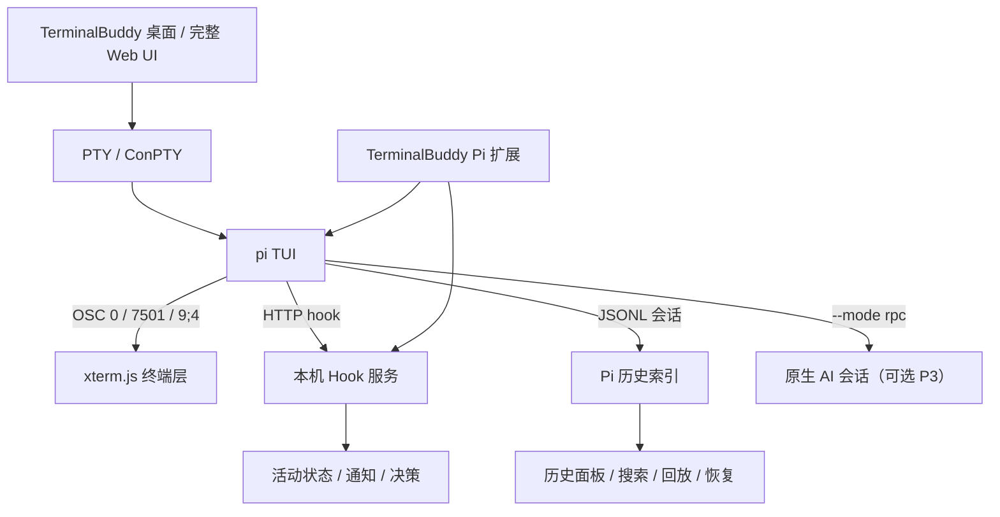

# Pi Agent 全面支持调研

调研日期：2026-10-26。依据：当前仓库源码（TerminalBuddy 1.8.0，master `4df2455`）、Pi 1.4.0 官方文档与源码、npm registry。

> 本文的“Pi”指 [pi.dev](https://pi.dev) 的 Pi coding agent（npm 包 `@earendil-works/pi-coding-agent`，TUI 标题 `π`），不是 Inflection Pi 或其他同名产品。
>
> 实施步骤见：[Pi Agent 实施计划](./Pi%20Agent%20实施计划.md)。

## 结论

**TerminalBuddy 目前对 Pi 只有“终端兼容层”，没有“一等公民”支持。**

已经完成的是 4 类 Pi 专属 TUI 兼容修复：全屏滚轮、IME 候选窗锚点、多行粘贴行尾、Shift/Ctrl+Enter 换行语义。它们让 Pi 在 TerminalBuddy 的 xterm.js 终端里基本可用，但没有接入 TerminalBuddy 的 Agent 管理、模型启动、会话历史、任务摘要、通知、配置面板、原生 AI 会话、Web/手机端和 Docker 运行时。

Pi 本身的可集成面非常好：

- CLI 提供交互 TUI、print、JSON 事件流、RPC 四种模式；
- 会话是结构稳定的 JSONL（v3 树形结构），可直接扫描索引；
- 扩展 API 提供 `session_start`、`input`、`agent_settled`、`tool_call`、`session_shutdown` 等事件，工具调用可拦截；
- 终端侧提供 OSC 0 标题、OSC 7501 程序状态、OSC 9;4 进度、OSC 52 剪贴板等能力；
- `--session-id`、`--session`、`--extension`、`--provider`、`--model` 等参数足以做精确绑定和启动控制。

建议采用 **“TUI 一等公民优先、原生 AI 会话后置”** 的路线：

1. **P0**：Agent 管理加入 Pi 的检测/安装/更新/基础命令；Docker 运行镜像补 Node；命令模板与文档。
2. **P1**：Pi 会话历史索引/搜索/回放/恢复；会话精确绑定、任务摘要、页签恢复、状态灯/通知；Pi 扩展桥。
3. **P1**：Pi 模型启动菜单（provider/model/thinking）；**P2**：Pi 配置面板（settings/models/auth/MCP/skills/packages）与项目级 Pi 开关。
4. **P3**：基于 Pi RPC 的原生 AI 会话，以及 Android/手机 SPA 的 Pi 支持（手机 SPA 已解冻）。

**最大阻塞项有三个：**

- Docker 运行镜像没有 Node（Pi 要求 Node.js ≥ 22.19）；
- Windows 上 Pi 需要 Node 与 Git Bash，而现有后台安装服务没有 TTY，不能依赖官方安装器的交互式 Node 安装；
- `web/` 手机 SPA 已解冻（2026-10-26 决策，允许 Pi 相关修改）；Android 端只做原生 AI 会话，二者都硬编码 Claude/Codex，Pi 移动端支持需要单独实施。

---

## 一、调研对象与版本

| 项 | 值 |
| --- | --- |
| 产品 | Pi（pi.dev），Earendil Inc. |
| 当前版本 | 1.4.0（2026-10-21 发布；调研日 npm latest 为 1.4.0） |
| npm 包 | `@earendil-works/pi-coding-agent` |
| 可执行文件 | `pi` |
| 运行时要求 | Node.js ≥ 22.19.0，npm |
| 安装方式 | `curl -fsSL https://pi.dev/install.sh \| sh`；Windows `powershell -c "irm https://pi.dev/install.ps1 \| iex"`；npm 全局安装；Nix |
| 默认配置目录 | `~/.pi/agent`（可用 `PI_CODING_AGENT_DIR` 覆盖） |
| 默认会话目录 | `~/.pi/agent/sessions/`（可用 `PI_CODING_AGENT_SESSION_DIR`、`--session-dir` 或 settings `sessionDir` 覆盖） |
| 许可证 | MIT |
| TUI 标题 | `π - <目录>` 或 `π - <会话名> - <目录>` |

Pi 的版本节奏很快：1.4.0 的 CHANGELOG 显示其仍在高频修复/新增功能，issue/PR 编号已到五位数。任何解析器和扩展桥都必须带版本探测与失败降级，不能假设格式永久不变。

---

## 二、TerminalBuddy 当前支持现状

### 2.1 已实现：Pi 的 TUI 兼容

| 能力 | 现状 | 源码依据 |
| --- | --- | --- |
| 全屏滚轮 | 检测到标题为 Pi、处于备用屏、应用未成功开启鼠标上报时，按 Pi 期望补发 SGR 滚轮报文，避免被 xterm 翻译成 ↑/↓ 翻输入历史 | `terminal-buddy/src/utils/terminalMouse.ts:3-17`；`terminal-buddy/src/components/terminal/TerminalInstance.tsx:495-503` |
| IME 候选窗 | 输入区没有 `>` 提示符、由上下全宽横线包围时，按真实光标格锚定；识别 `── ↑ 12 more ──` 这类滚动指示边框 | `terminal-buddy/src/components/terminal/terminal-helpers.ts:119-126`、`:311-330` |
| 多行粘贴 | 粘贴行尾统一为 CR，避免 ConPTY 把 LF 当 Ctrl+Enter，导致 Pi 等 kitty 协议 TUI 逐行误提交或插入 `CSI 13;5u` 字面量 | `terminal-buddy/src/components/terminal/TerminalInstance.tsx:138-145` |
| 换行/提交 | 应用层拦截 Ctrl+Enter / Shift+Enter 并发送 LF；Pi TUI 把 LF 视为 `tui.input.newLine`，与 Pi 的输入框语义兼容 | `terminal-buddy/src/components/terminal/TerminalInstance.tsx:1041-1046` |
| 基础终端能力 | 真彩、Unicode 11、WebLinks（OSC 8）、Clipboard（OSC 52）、搜索、WebGL 渲染、备用屏 | `terminal-buddy/src/components/terminal/TerminalInstance.tsx:438-474` |

**未覆盖的 TUI 细节：**

- 没有解析 Pi 的 OSC 7501 程序状态（working / blocked / done / error / idle）；
- 没有解析 Pi 的 OSC 9;4 终端进度；
- 没有利用 Pi 的 OSC 0 标题做标签页命名/应用识别（目前只用于滚轮 fallback）；
- 没有针对 Pi 的图片协议做能力降级（xterm.js 不支持 kitty/iTerm2 内联图片，建议设置 `PI_IMAGE_PROTOCOL=none`）；
- 手机 SPA 使用独立的 `web/src/components/Xterm.tsx`，没有桌面端新增的 Pi 滚轮 fallback 和 IME 锚点修复；
- Pi 的 Ctrl+C / Ctrl+V / Ctrl+O / Ctrl+T / Shift+Tab / Alt+Enter 等键位与 TerminalBuddy 的终端拦截逻辑没有专项回归测试。

### 2.2 完全缺失：Agent 级能力

| 能力 | 现状与证据 |
| --- | --- |
| Agent CLI 管理 | `CliTool` 只有 `Claude`、`Codex`；`Environment` 只有 `claude`、`codex` 两个字段。见 `terminal-buddy/src-tauri/src/services/agent_cli_service.rs:31-65`、`:92-97`。REST 的 `CliToolParam` 也只有两种。 |
| 基础启动命令 | `AgentCommands` 只有 `claude`、`codex`；保存命令 `save_agent_commands` 只有两个参数。见 `terminal-buddy/src-tauri/src/models/settings.rs:120-135`、`terminal-buddy/src-tauri/src/commands/settings.rs:127-134`。 |
| 安装/更新 UI | `AgentManagementSettings` 的工具数组只有 Claude Code、Codex CLI；所有状态 Record 都写死两项。见 `terminal-buddy/src/components/settings/AgentManagementSettings.tsx:14-15`、`:39-51`。 |
| 项目 Agent 开关 | `EnabledAgents` 只有 `claude`、`codex`。见 `terminal-buddy/src-tauri/src/commands/profile.rs:71-87`；前端 `terminal-buddy/src/types/index.ts:7-24` 同样如此。 |
| 模型启动/供应商 | 模型菜单只有 Claude/Codex 两个 source；`parseModelRef` 只识别 Claude/Codex 引用。见 `terminal-buddy/src/components/shared/ClaudeModelMenuSection.tsx:14`、`terminal-buddy/src/utils/codexLaunch.ts:13-15`。 |
| 会话历史 | `SessionHistoryProvider = 'claude' \| 'codex'`；历史面板标签页只渲染两项。见 `terminal-buddy/src/types/index.ts:1`、`terminal-buddy/src/components/claude-history/HistoryPanel.tsx:597-615`。 |
| 历史恢复 | `resumeClaudeSession` 拼 `--resume`，`resumeCodexSession` 拼 `codex resume`；没有 Pi 的 `pi --session`。 |
| 任务摘要 | `terminal_task_service` 只维护 `claude_root`、`codex_root`，只解析 Claude/Codex transcript。见 `terminal-buddy/src-tauri/src/services/terminal_task_service.rs:18-39`、`:217-255`。 |
| 活动指示灯 | `TerminalRuntimeKind` 只有 `'shell' \| 'claude'`；指示灯文案全部写“Claude”。见 `terminal-buddy/src/stores/appStore.ts:55-56`、`terminal-buddy/src/utils/claudeIndicator.ts:1-30`。 |
| 桌面/机器人通知 | Claude Hook 事件驱动；Codex 只有原生 AI 会话的审批，TUI 没有同等 Hook。Pi 无接入。 |
| 容器重启恢复 | `claudeSessionIds` + `claude_session_registry.json` 只恢复 Claude；`sessionRestore.ts` 硬编码 `--resume`。见 `terminal-buddy/src/services/sessionRestore.ts:88-103`、`terminal-buddy/src-tauri/src/services/claude_session_registry_service.rs:1-6`。 |
| 配置面板 | Claude 面板包含模型、默认配置、Memory、CLAUDE.md、技能资产、MCP；Pi 没有对应的 settings/models/auth/MCP/扩展/技能/包管理面板。 |
| 原生 AI 会话 | `ai_chat_service` 只支持 `claude`、`codex` 两种 provider。见 `terminal-buddy/src-tauri/src/services/ai_chat_service.rs:109`、`:376-383`。 |
| Web/手机端 | 完整 Web UI 复用 `src/`，可随桌面端一起扩展；`web/` 手机 SPA 已解冻（Pi 支持排 P3）且只支持 Claude/Codex；Android 原生客户端只支持 Claude/Codex。 |
| Docker 运行时 | 运行镜像基于 `debian:bookworm-slim`，没有 Node/npm；Pi 无法安装或运行。见 `Dockerfile:44-66`。 |
| Windows 运行时 | Pi 需要 Node ≥ 22.19 与 Git Bash；现有后台安装服务没有 Node 预检，也没有 Git Bash 检查。 |

---

## 三、能力矩阵

| 能力 | Claude Code | Codex CLI | Pi |
| --- | --- | --- | --- |
| 终端 TUI 运行 | ✅ | ✅ | ⚠️ 已有 4 项兼容修复，未做状态/进度/移动端专项 |
| Agent 管理（检测/安装/更新） | ✅ | ✅ | ❌ |
| 基础启动命令设置 | ✅ | ✅ | ❌ |
| 项目/连接启动 | ✅ | ✅ | ⚠️ 可手写任意 startupCommands，但无内置模板/菜单 |
| 指定模型启动 | ✅ | ✅ | ❌ |
| 会话历史/搜索/回放 | ✅ | ✅ | ❌ |
| 历史会话恢复 | ✅ | ✅ | ❌ |
| 任务摘要标签 | ✅ | ✅ | ❌ |
| 活动指示灯 | ✅ | ⚠️（原生 AI 有状态，TUI 无 Hook） | ❌ |
| 桌面/机器人通知 | ✅ | ⚠️（原生 AI 审批） | ❌ |
| 远程决策（手机/群聊） | ✅ | ⚠️（原生 AI 审批） | ❌ |
| 容器重启后自动续接 | ✅ | ❌ | ❌ |
| 配置面板 | ✅（完整 Claude 面板） | ⚠️（仅供应商配置） | ❌ |
| 原生 AI 会话 | ✅ | ✅ | ❌ |
| 完整 Web UI | ✅ | ✅ | ❌ |
| 手机 SPA | ✅ | ✅ | ❌ |
| Android 原生客户端 | ✅ | ✅ | ❌ |
| Docker 运行 | ✅ | ✅ | ❌（缺 Node） |
| Windows 运行 | ✅ | ✅ | ⚠️（需 Node/Git Bash） |

---

## 四、Pi 提供的集成接口

### 4.1 CLI 四种模式

| 模式 | 命令 | 用途 |
| --- | --- | --- |
| 交互 TUI | `pi` | TerminalBuddy 终端标签页的主路径 |
| Print | `pi -p "..."` | 一次性任务，最终文本写 stdout |
| JSON 事件流 | `pi --mode json "..."` | 单次运行的结构化事件，适合脚本/轻量集成 |
| RPC | `pi --mode rpc` | 长驻 stdio JSONL，适合原生 AI 会话/编辑器嵌入 |

关键启动参数：

- 会话：`-c/--continue`、`-r/--resume`、`--session <path|id>`、`--session-id <id>`、`--fork`、`--session-dir`、`--no-session`、`-n/--name`
- 模型：`--provider`、`--model`、`--thinking`、`--models`、`--list-models`
- 资源：`-e/--extension`、`--skill`、`--prompt-template`、`--theme`、`-nc/--no-context-files`
- 界面：`--tui-mode fullscreen|regular`
- 信任：`-a/--approve`、`-na/--no-approve`
- 离线：`--offline`

TerminalBuddy 首期只需要 TUI 模式；原生 AI 会话再使用 RPC。

### 4.2 会话 JSONL 格式

默认路径：

```text
~/.pi/agent/sessions/--<编码后的 cwd>--/<timestamp>_<session-id>.jsonl
```

目录编码：去掉路径开头的分隔符，把 `/`、`\`、`:` 替换为 `-`。例如 `/workspace/project` → `--workspace-project--`。

文件结构：

- 首行是 `session` 头：`type`、`version`（当前 v3）、`id`（UUIDv7）、`timestamp`、`cwd`、可选 `parentSession`。
- 其余每行是一个 tree entry：`type`、`id`、`parentId`、`timestamp`。
- `message` entry 的 `message` 是 AgentMessage：`user` / `assistant` / `toolResult` / `system`；assistant 含 `content` 块、`usage`、`model`、`stopReason`。
- 其他 entry：`model_change`、`thinking_level_change`、`usage`、`compaction`、`context_edit`、`branch_summary`、`custom`、`custom_message`、`label`、`session_info`。
- 活动分支的叶节点是文件中最后一个非 header entry；沿 `parentId` 回溯即可得到当前分支。
- `session_info.name` 是会话显示名；没有时可用第一条 user 消息作标题。
- `compaction`/`branch_summary` 是摘要，不应被当作普通助手消息；`system` 消息可能包含完整系统提示与工具声明，历史索引应跳过或截断。

这比 Codex 的线性 rollout 复杂：Pi 是树，支持分支、压缩、上下文编辑。**回放要按活动分支重建，不能简单按行顺序全部展示。**

### 4.3 扩展事件与工具拦截

Pi 扩展是 Pi 进程内的 TypeScript/JavaScript 模块，默认从 `~/.pi/agent/extensions/` 或项目的 `.pi/extensions/` 加载，也可用 `-e/--extension` 单次加载。

与 TerminalBuddy 相关的事件：

| 事件 | 用途 |
| --- | --- |
| `session_start` | 上报会话 ID、会话文件、启动原因（startup/resume/new/fork） |
| `input` | 用户提交的提示词，可用于任务摘要 |
| `agent_start` / `agent_settled` | 运行开始/真正结束（`agent_settled` 才是最终空闲信号） |
| `message_update` / `message_end` | 流式文本与最终消息 |
| `tool_call` | 工具调用前；可返回 `{ block: true, reason }` 阻止执行 |
| `tool_execution_start/update/end` | 工具执行状态/进度 |
| `session_shutdown` | 会话结束/退出 |
| `ctx.sessionManager` | 读取当前 session ID、session file、entries、树 |

扩展拥有与 Pi 相同的系统权限，因此 TerminalBuddy 的扩展桥必须随应用签名/校验发布，不能从远程动态下发。

### 4.4 终端协议

| 协议 | 内容 | 对 TerminalBuddy 的用途 |
| --- | --- | --- |
| OSC 0 | 窗口/标签标题：`π - <会话名> - <目录>` 或 `π - <目录>` | 识别 Pi、辅助标签命名 |
| OSC 7501 | 程序状态：`state=working/blocked/done/error/idle`、`app=pi`、`kind=permission/question/auth`、base64 `msg` | 活动指示灯、完成/失败通知、等待确认通知 |
| OSC 9;4 | 终端进度（indeterminate/clear） | 标签进度指示（可选） |
| OSC 52 | 剪贴板 | Web/远程终端复制 |
| OSC 8 | 超链接 | xterm WebLinks 已支持 |
| Kitty/iTerm2 图片 | 内联图片 | xterm.js 不支持，建议 `PI_IMAGE_PROTOCOL=none` |
| Kitty 键盘协议 | 修饰键/Shift+Enter 区分 | 已有部分处理，需 Pi 专项回归 |

Pi 只在终端确认支持 OSC 7501 或设置 `PI_PROGRAM_STATUS=1` 时才发送状态；TerminalBuddy 可以在启动 Pi 的终端环境里直接设置 `PI_PROGRAM_STATUS=1`，避免实现终端查询应答。

### 4.5 配置与生态

| 路径/命令 | 内容 |
| --- | --- |
| `~/.pi/agent/settings.json` | 用户设置：默认模型/思考级别、TUI 模式、sessionDir、终端显示、压缩、包列表等 |
| `~/.pi/agent/models.json` | 自定义 provider/model、内置模型覆盖（JSON Schema：`https://pi.dev/schemas/models.schema.json`） |
| `~/.pi/agent/auth.json` | API key / OAuth 凭据（敏感） |
| `~/.pi/agent/mcp.json` | 用户级 MCP 服务器 |
| `~/.pi/agent/extensions/`、`skills/`、`prompts/`、`themes/` | 用户级扩展、技能、提示模板、主题 |
| `~/.pi/agent/AGENTS.md`、`CLAUDE.md`、`SYSTEM.md`、`APPEND_SYSTEM.md` | 用户级上下文/系统提示 |
| `<project>/.pi/` | 项目级 settings/mcp/extensions/skills/prompts/themes/SYSTEM.md |
| `pi install/list/remove/update` | Pi packages（npm/git/本地） |
| `pi mcp add/remove/list/login/logout` | MCP 管理 |
| `pi auth check --json` | 只读鉴权状态（ready/not_ready/invalid），不暴露密钥 |

Pi 的技能遵循 Agent Skills 规范，支持 `~/.agents/skills/` 与 `.agents/skills/`；这与 TerminalBuddy 现有 Claude 资产库的 `SKILL.md` 结构兼容，可以复用资产库做 Pi 技能部署。

### 4.6 RPC 与 SDK

RPC 使用严格 JSONL：

- 启动：`pi --mode rpc --no-session`（或其他会话参数）
- stdin 写 Command，stdout 读 `response` / session event / extension UI record
- 关键命令：`prompt`、`steer`、`follow_up`、`abort`、`get_state`、`get_messages`、`set_model`、`set_thinking_level`、`get_session_stats`、`switch_session`、`fork`、`clone`、`export_html`、`bash`
- 关键事件：`message_update`、`message_end`、`tool_execution_*`、`compaction_*`、`agent_end`、`agent_settled`
- 注意：stdout 只用于协议；不要用 Node `readline` 分帧（U+2028/U+2029 不是记录边界），Rust 侧用按 `\n` 分帧的 BufReader 即可。

TypeScript SDK 适合 Node 进程内嵌入，不适合 TerminalBuddy 的 Rust 后端直接使用；如果做原生 AI 会话，RPC 是跨语言首选。

---

## 五、推荐实现方案

### 5.1 P0：让 Pi 能被安装、启动、发现

**目标：用户能在 Agent 管理里看到 Pi，能安装/更新，能在项目里一键启动 `pi`。**

1. **扩展 Agent CLI 模型**
   - `CliTool` 增加 `Pi`，binary `pi`，name `Pi`，package `@earendil-works/pi-coding-agent`。
   - `Environment` 增加 `pi`；REST `CliToolParam` 增加 `pi`。
   - `AgentCli` 前端类型、`AgentManagementSettings` 工具数组、`agentCommands` 增加 `pi`。
   - `AgentCommands` 增加 `pi: String`，默认空串回退内置 `pi`；`save_agent_commands` 增加第三个参数或改为对象（注意 Web 兼容）。
   - `EnabledAgents` 增加 `pi`，默认 `true`；同步 `src/types/index.ts` 与 Android `AiAgents`（如果本期做 Android）。
2. **版本检测**
   - `pi --version` 输出裸 semver（如 `1.4.0`），解析 3 段版本。
   - 候选路径：PATH、`~/.local/bin/pi`、`~/bin/pi`、`~/.pi/agent/bin/pi`、Windows 的 `.exe/.cmd/.bat/.ps1` shim。
   - 为避免把其他同名 `pi` 误判为 Pi，额外用 `pi --help` 中是否包含 `--mode`、`--session-dir`、`--extension` 等签名校验。
3. **安装/更新**
   - Docker：运行镜像补 Node 24（见 5.1.5），设置 `NPM_CONFIG_PREFIX=/home/terminalbuddy/.local`，然后 `npm install -g --ignore-scripts @earendil-works/pi-coding-agent[@version]`。
   - 桌面：先检测 `node --version` ≥ 22.19 与 `npm`；满足则用 npm 全局安装到用户可写前缀；不满足则明确提示安装 Node（不要静默安装宿主运行时）。
   - 更新检查复用 `cli_update_service` 查 npm dist-tags `latest`；更新执行 npm install 指定版本，再用 `pi --version` 校验。
   - 不建议直接调用官方 install.sh/ps1 作为后台安装主路径：它们没有 `--yes`，缺 Node 时会等待 TTY，Windows 还会 `Read-Host` 询问 PATH；在 TerminalBuddy 的无 TTY 后台任务里不可靠。官方脚本可以作为“修复安装”或用户手动路径。
   - 安装失败日志沿用 `agent_cli_service` 的持久化逻辑。
4. **默认命令/模板/文档**
   - `DEFAULT_PI_COMMAND = 'pi'`；Agent 管理基础命令输入框。
   - 命令模板“AI 助手”增加：`pi`、`pi -c`、`pi -r`、`pi --session <id>`、`pi -p "..."`、`pi --tui-mode regular`。
   - README/README_zh 的 Agent CLI 章节增加 Pi 的安装要求（Node 22.19、Windows Git Bash）、登录方式（`/login`）、配置目录。
5. **Docker 运行时**
   - 把运行阶段从 `debian:bookworm-slim` 换成 `node:24-bookworm-slim`，或从 Node 镜像复制 `node`/`npm`。
   - 保留现有 apt 包（bash、curl、git、openssh-client、libssl3、libssh2-1、tini、procps）。
   - `PATH` 已包含 `/home/terminalbuddy/.local/bin`，npm 全局前缀设到该目录即可。
   - 镜像体积会增加；可作为独立层/多阶段复制，避免把完整 Node 开发工具带进运行镜像。

估算：3–5 人日（含 Docker 回归）。

### 5.2 P1：让 Pi 成为“会话一等公民”

#### 5.2.1 Pi 历史索引服务

新增：

- `src-tauri/src/services/pi_transcript.rs`：纯函数解析器，带 fixture 单测。
- `src-tauri/src/services/pi_history_service.rs`：扫描、索引、列表、搜索、回放、重命名、标记、删除、导出。
- `src-tauri/src/commands/pi_history.rs` + `commands/mod.rs` + `lib.rs` 注册。
- SQLite migration `pi-history-v1`：
  - `pi_sessions(session_id, file_path, file_mtime, file_size, project_dir, updated_at, item_json)`
  - `pi_session_meta(session_id, custom_title, starred, archived)`
  - `pi_messages(session_id, seq, content, timestamp)`
  - `pi_index_state(key, value)`，存 analyzer_version
- 前端：
  - `SessionHistoryProvider` 增加 `'pi'`；
  - `sessionHistory.ts` 增加 pi provider；
  - `HistoryPanel` 标签页增加到三项；
  - `ReplayPage` 的 provider 名称映射；
  - `resumePiSession.ts` 构造 `pi --session <path>`；
  - `src/services/tauri/piHistory.ts` 与类型。

解析要点：

- 根目录按优先级：`PI_CODING_AGENT_SESSION_DIR` → `settings.sessionDir` → `~/.pi/agent/sessions`；`PI_CODING_AGENT_DIR` 影响默认 agent 目录。
- 只读，不修改 Pi 的会话文件；删除走 TerminalBuddy 回收目录（复用 `move_to_trash`）。
- 会话 ID 取 header `id`；缺失时回退文件名后缀。
- 项目目录取 header `cwd`；缺失时尝试从目录名反解。
- 标题优先级：TerminalBuddy 自定义标题 → `session_info.name` → 第一条 user 消息 → `Pi 会话 <短 ID>`。
- 消息计数/Token/模型按活动分支统计；搜索可索引所有分支，但回放只展示活动分支。
- 跳过/截断 `system` 消息、base64 图片、超长工具输出；避免数据库膨胀和敏感信息泄漏。
- 支持 v2/v3；v1 旧格式按线性序列处理。Pi 自己会在打开时迁移，TerminalBuddy 不应改写。
- analyzer_version 变化时重建索引。

估算：11–15 人日（解析器 + 服务 + 前端 + 测试）。

#### 5.2.2 会话精确绑定与任务摘要

现状问题：`terminal_task_service` 只认 Claude/Codex；Pi 新会话在启动时没有已知 ID，靠“目录里最新文件”会串到同目录其他 Pi 会话。

推荐三层方案：

1. **启动注入（最可靠）**
   - 在 `prepare_launch` 检测到命令是 `pi` 且没有 `--session`、`--session-id`、`--continue`、`--resume`、`--fork`、`--no-session` 时，追加 `--session-id <预生成 UUID>`。
   - 同时记录 `provider=pi`、`session_id` 到 `TrackedTerminal`。
   - 这要求命令改写支持 cmd/PowerShell/bash 的引号规则；可先只对“命令首个 token 是 pi”的简单形式启用，复杂 shell 片段保持原样。
2. **Pi 扩展上报（最通用）**
   - 在 `session_start` 事件中读取 `ctx.sessionManager.getSessionFile()` 与 `getSessionId()`，通过本机 HTTP 上报 `terminalId`、`sessionId`、`sessionFile`、`reason`。
   - 这样即使用户手动输入 `pi`、使用 `-c`/`-r`、或使用 `--session-dir`，也能精确绑定。
3. **扫描兜底（无需扩展）**
   - 按终端启动时间与 cwd 扫描 `~/.pi/agent/sessions/--<cwd>--/`，取启动后修改的最新文件；只有唯一候选时才绑定，多个候选不猜。
   - 适合没有安装扩展、且同一目录只有一个 Pi 会话的普通场景。

任务摘要：

- 扩展桥/注入拿到 session ID 后，`terminal_task_service` 新增 `pi_root` 与 `pi` transcript 解析；
- 标题、模型、Token 从 Pi JSONL 读取；
- `TerminalTaskSummary.provider` 增加 `'pi'`，前端 `SessionTaskLabel`、`TabNav.css`、`taskSummaryStore` 增加 Pi 标签/颜色；
- Web 终端任务摘要与桌面共用。

估算：5–8 人日（含扩展桥的绑定部分）。

#### 5.2.3 页签恢复

现有 `sessionRestore.ts` 只处理 Claude 的 `--resume`；Codex 也没有容器重启自动恢复。建议不要新增第三个 `piSessionId` 字段，而是把现有机制泛化为：

- `agentSessionRegistry.json`：`terminalId -> { provider, sessionId, sessionFile, cwd, updatedAt }`；
- 前端保存 `agentSession: { provider, sessionId, sessionFile }`，恢复时按 provider 拼命令：
  - Claude：`claude --resume <id>`
  - Codex：`codex resume <id>`（可顺带补齐现有缺口）
  - Pi：`pi --session <sessionFile 或 id>`
- `stripResumeArgs` 增加 Pi 的 `--session`/`--session-id` 剥离规则，避免重复叠加；
- 恢复后写回 registry；容器重启后从 registry 回填。

估算：可与 5.2.2 合并，额外 2–3 人日。

#### 5.2.4 活动状态、通知与决策

**第一层：OSC 7501（无需扩展，覆盖手动 Pi）**

- 在 `TerminalInstance` 注册 `terminal.parser.registerOscHandler(7501, ...)`；
- 解析 `state=...:app=pi:kind=...:msg=<base64>`；
- 映射：
  - `working` → `running`
  - `blocked`（permission/question/auth）→ `attention`
  - `done` → `completed`
  - `error` → `failed`
  - `idle`/`clear` → `idle`
- 启动 Pi 的终端环境设置 `PI_PROGRAM_STATUS=1`，强制 Pi 发送状态；
- 需要把 `TerminalActivityState` 从 `runtimeKind: 'shell'|'claude'` 泛化为 `runtimeKind: 'shell'|'agent'` + `provider`，指示灯文案按 provider 显示，避免以后每加一个 Agent 都改一遍。

**第二层：Pi 扩展桥（推荐，覆盖精确事件）**

- 随应用发布一个 `terminal-buddy-pi-extension.js`，内容：
  - 读取 `TERMINAL_BUDDY_TERMINAL_ID`、`TERMINAL_BUDDY_HOOK_TOKEN`、`TERMINAL_BUDDY_HOOK_PORT`；缺失则 no-op；
  - `session_start` → POST `SessionStart`（provider=pi, sessionId, sessionFile, reason）；
  - `input` → POST `UserPromptSubmit`（prompt 文本）；
  - `agent_start`/`tool_call` → 心跳；
  - `agent_settled` → POST `Stop` 或 `StopFailure`（依据最后的 assistant `stopReason`）；
  - `session_shutdown` → POST `SessionEnd`；
  - 可选 `tool_call` 工具确认：POST 到本机 Hook 服务，等待 TerminalBuddy/手机返回允许/拒绝，返回 `{ block }`；本期实现，默认关闭。
- 安装方式：
  - 推荐：用户同意后安装到 `~/.pi/agent/extensions/terminal-buddy.js`，全局生效；
  - 备选：启动命令追加 `--extension <应用数据目录>/PiAgent/terminal-buddy.js`，只对 TerminalBuddy 启动的 Pi 生效；
  - 两者都失败时退回 OSC 7501。
- 服务端：
  - 复用 `/api/claude/hooks` 的鉴权/事件管线，增加 `provider=pi` 分支与 `record_agent_session`；
  - 或新增 `/api/pi/hooks`，避免把 Pi 语义塞进 Claude 服务；
  - 决策卡片复用现有 pending/notification/decision 基础设施，前端文案按 agent 动态显示。
- 安全：
  - Pi 默认不询问工具权限，扩展审批会改变 Pi 行为，必须默认关闭并明确提示；
  - 扩展拥有完整系统权限，必须由 TerminalBuddy 安装包校验，不允许远程下发。

估算：7–11 人日（扩展 + 服务端 + 前端状态/通知 + 工具确认）。

### 5.3 P1/P2：配置面板与模型启动

> 模型启动菜单已确认纳入本期 P1（M4/P1b）；配置面板仍为 P2。

#### 5.3.1 Pi 配置面板

建议新增独立“Pi”面板（或把 Claude 面板泛化为 Agent 面板），包含：

- **设置**：`settings.json` 结构化编辑 + JSON 原文 + Schema 校验 + 最近 N 份备份；
- **模型**：`models.json` 编辑/校验；`pi --list-models` 查看可用模型；内置 provider 覆盖；
- **鉴权**：`pi auth check --json` 状态列表；不显示 key；提供“在终端中运行 `/login`”按钮；
- **MCP**：`pi mcp list --json`、添加/删除/登录/登出；用户级 `mcp.json` 与项目 `.pi/mcp.json`；
- **技能/提示模板/主题**：复用现有 ClaudeAssets 库，增加 Pi 部署目标（`~/.pi/agent/skills`、`.pi/skills`、prompts、themes）；注意 Pi 无内置 subagents，Claude 的 agents 资产不直接映射；
- **Pi packages**：`pi list`、`pi install <source>`、`pi remove <source>`、`pi update --extensions`；显示资源来源；
- **Memory/系统提示**：`AGENTS.md`、`CLAUDE.md`、`SYSTEM.md`、`APPEND_SYSTEM.md` 编辑；
- **终端设置**：`tuiMode`、`theme`、`terminal.showImages`、`terminal.showTerminalProgress`、`fullscreenWheelScrollLines` 等常用项。

注意：Pi 的 `/login` 是交互式流程，TerminalBuddy 无法后台完成；面板只能展示状态并引导用户打开终端登录。

估算：10–14 人日。

#### 5.3.2 模型启动菜单

不要让 TerminalBuddy 的 Claude/Codex 供应商表去“翻译” Pi 的模型；**Pi 自己就是模型/供应商的权威来源**。

- 后端增加 `get_pi_models`：运行 `pi --list-models` 解析表格，或用 RPC `get_available_models` 拿结构化数据；
- 模型菜单增加 `source: 'pi'`，按 provider 分组展示；
- 新增 `__TB_PI_REF__:<provider>:<model>` 引用标记；
- 展开为 `pi --provider <provider> --model <model> --thinking <level>`，并从基础命令中剥离冲突的 `--model`、`--provider`、`--thinking`、`--models`、`--api-key`；
- 历史恢复同样支持指定模型；
- 标签 chip 用 `parseModelRef` 识别 Pi。

估算：4–6 人日。

### 5.4 P3：原生 AI 会话与跨端

#### 5.4.1 Pi RPC 原生会话

如果希望 Android/手机端也能使用 Pi，而不只是终端 TUI：

- `ai_chat_service` 增加 `provider = "pi"` 的 driver；
- 启动 `pi --mode rpc`（可带 `--session-dir`/`--session-id`），按 LF 分帧读取 JSONL；
- 映射：
  - 用户消息 → `prompt`
  - 流式文本 → `message_update` 的 `text_delta`
  - 最终消息 → `message_end`
  - 工具卡片 → `tool_execution_*`
  - 完成 → `agent_settled`
  - 失败 → `message_end.stopReason=error` / `agent_settled.aborted`
  - 审批 → `extension_ui_request` 或 TerminalBuddy Pi 扩展的 `tool_call` 审批
- 会话持久化：直接使用 Pi 的 session 文件（推荐），`AiSession` 只存元数据与 session ID；或每回合 `get_messages` 同步到 `AiSessions/*.json`（会重复存储，不推荐）；
- 权限：Pi 没有内建审批；要么接受“Pi 全权限”的定位，要么通过扩展桥提供可选审批。不要假装与 Claude 的权限模型等价。

估算：15–25 人日（含 RPC 客户端、事件映射、审批、测试）。

#### 5.4.2 Web/手机/Android

- 完整 Web UI 复用 `src/`，P0–P2 完成后自然具备 Pi 的 Agent 管理、历史和终端；需要补 `/api/runtime` 的 `agentCommands.pi` 与 REST `CliToolParam`。
- `web/` 手机 SPA 已解冻，且 `web/src/types.ts`、`Settings.tsx`、`InputBar.tsx` 都写死 Claude/Codex；Pi 的移动端支持需要至少补：
  - Pi provider 类型与图标；
  - Shift+Tab、Ctrl+O、Ctrl+T、Alt+Enter/Ctrl+Q、Ctrl+P、Ctrl+R、Ctrl+G 等特殊键；
  - Pi 的滚轮/IME 兼容（手机 SPA 的 xterm 与桌面端不是同一份代码）。
- Android 原生客户端目前只做原生 AI 会话，不支持终端 TUI；Pi 支持需要：
  - `AiAgents` 增加 pi；
  - `AiViewModel.availableAgents` 增加 pi；
  - `AiAgentLogo` 增加 Pi 图标；
  - provider 标签/项目 `enabledAgents`；
  - 审批 UI 泛化。

估算：手机 SPA 5–8 人日；Android 8–12 人日（不含应用商店发布）。

---

## 六、推荐架构



### 关键设计决策

1. **扩展优先，OSC 兜底。** 扩展能拿到精确 session ID/file、输入、工具调用和结束事件；OSC 7501 只用于手动启动、没有扩展时的状态灯/通知兜底。
2. **精确绑定优先。** 新会话用 `--session-id` 预生成或扩展上报；不要用“目录最新会话”当主路径，否则同目录多开必串。
3. **历史解析器只读。** 不修改 Pi 的 JSONL；重命名/收藏/归档存 TerminalBuddy 自己的 SQLite；删除移动到应用回收目录。
4. **Pi 是模型/供应商的权威。** 模型菜单从 `pi --list-models`/RPC 获取，不复制 Pi 的 provider 配置到 TerminalBuddy 供应商表。
5. **先泛化再扩展。** 把 `AgentCommands`、`EnabledAgents`、`SessionHistoryProvider`、`TerminalActivityState`、`AgentSessionRegistry` 从 Claude/Codex 二元硬编码泛化为 provider 描述符，否则 Pi 会让每个分支再复制一遍，后续再加 Agent 成本更高。
6. **安全边界明确。** Pi 默认全权限、无内建审批；TerminalBuddy 的工具确认本期实现、默认关闭，并在 UI 中说明它会改变 Pi 的行为。
7. **`web/` 已解冻（仅 Pi 相关改动）。** 桌面/完整 Web 共用 `src/`，可以完整支持 Pi；手机 SPA 是独立代码，P3 按 Pi 需求修改，不做全量重构。

---

## 七、测试矩阵

| 场景 | 必测项 |
| --- | --- |
| Windows 10/11 + ConPTY | Pi 全屏启动/退出、滚轮、IME 候选窗、Shift+Enter、Ctrl+Enter、Alt+Enter、多行粘贴、Ctrl+C/V、窗口缩放、`--tui-mode regular` |
| Linux / Docker | Pi 安装、Node 版本、npm 前缀、TUI 通过 WebSocket、OSC 7501、OSC 52、中文输入、多会话 |
| 完整 Web UI | 浏览器 xterm 的 Pi 滚动/IME/剪贴板、Agent 管理、历史面板、页签恢复 |
| 手机 SPA | 触摸滚轮、软键盘、特殊键、中文 IME（已解冻，P3） |
| 会话历史 | v1/v2/v3、分支、压缩、context_edit、超长工具输出、图片、损坏文件、重名 ID |
| 恢复 | 同目录多 Pi 会话、`--session` 路径含空格/中文、容器重启、会话文件被删除 |
| 任务摘要 | 手动输入 `pi`、`-c`、`-r`、`--session`、扩展安装/未安装、同目录多会话 |
| 升级 | 1.4.0 → 后续版本；session format/analyzer version 变化；RPC 未知事件 |
| 安全 | 扩展缺失/损坏、Hook token 无效、审批拒绝、Pi 全权限提示 |

---

## 八、风险

| 风险 | 影响 | 缓解 |
| --- | --- | --- |
| Pi 版本节奏快 | 会话格式/扩展 API/RPC 事件变化，解析器失效 | 固定测试版本 1.4.0；analyzer_version；未知 entry/event 跳过；启动时版本探测 |
| Docker 无 Node | Pi 完全无法运行 | 运行镜像补 Node 24；npm 前缀指向 `~/.local` |
| Windows 无 Node/Git Bash | 无法安装或 bash 工具失败 | 预检 Node ≥ 22.19、npm、Git Bash；给出明确指引；不要依赖交互式安装器 |
| Pi 无内建审批 | 工具全权限执行，与 Claude 的审批体验不一致 | 明确产品定位；工具确认本期可用但默认关闭；文档警示 |
| Pi 扩展拥有完整权限 | 供应链/远程代码风险 | 扩展随应用发布、校验哈希、用户显式安装；不从远程更新 |
| 会话树复杂 | 回放/搜索按行解析会展示废弃分支或压缩前内容 | 按 `parentId` 重建活动分支；compaction/branch_summary 特殊处理；fixture 测试 |
| 同目录多会话 | 任务摘要/恢复串会话 | `--session-id` 注入 + 扩展上报；扫描只在唯一候选时绑定 |
| 会话文件包含敏感信息 | 历史/搜索/导出泄漏密钥、命令输出 | 跳过 system/base64；导出前提示；数据库/日志不落敏感内容 |
| 手机 SPA 已解冻但改动面大 | 移动端 Pi 支持成本高 | P3 单独立项；只改 Pi 相关 provider/键盘/历史/设置；不做全量重构 |
| `pi` 二进制重名 | 误把其他 `pi` 命令当 Pi | `--help` 签名校验；版本解析严格 |
| 远程 SSH 场景 | Hook 服务在本地，远程 Pi 上报不到 | 首期只承诺本地/Docker；远程 SSH 仅 TUI 兼容 |
| xterm.js 不支持图片协议 | Pi 内联图片显示为乱码/占位 | `PI_IMAGE_PROTOCOL=none`；后续再做图片协议 |
| 移动端键位不全 | Pi 在手机 SPA 上难以操作 | 补特殊键；或推荐 `--tui-mode regular` + 外接键盘 |

---

## 九、工作量估算

以下为一名熟悉本仓库的开发者粗略估算，不含发布、应用商店审核与大规模回归。

| 阶段 | 内容 | 估算 |
| --- | --- | --- |
| P0 | Agent 管理 + npm 安装/更新 + Docker Node + 命令模板 + 文档 | 4–7 人日 |
| P1a | Pi 历史解析/索引/搜索/回放/导出 + 前端 | 11–15 人日 |
| P1b | 会话绑定 + 任务摘要 + 页签恢复（含泛化 registry、Codex 恢复、模型菜单、项目 Pi 开关） | 13–17 人日 |
| P1c | Pi 扩展桥 + OSC 7501 + 状态灯/通知 + 工具确认 | 7–11 人日 |
| P2 | Pi 配置面板 + 技能/MCP/包管理 | 10–14 人日 |
| P3 | Pi RPC 原生 AI 会话 | 15–25 人日 |
| P3 | 手机 SPA + Android 支持 | 10–15 人日 |
| **TUI 一等公民合计（P0–P1）** | | **约 11–12 周（单开发者；2–3 人约 6–7 周）** |
| **全面支持合计（P0–P3）** | | **约 4.5–5 个月（单开发者；2–3 人约 3–3.5 个月）** |

建议先做 P0 + P1a/P1b 的最小闭环：**能装、能启动、能看历史、能恢复、能显示任务摘要**；P1c 的扩展桥紧随其后，因为它同时解决精确绑定、状态灯、通知和工具确认四个问题。

---

## 十、结论与建议

1. **Pi 值得做一等公民支持。** 它的会话 JSONL、扩展事件、OSC 7501 和 RPC 都是为外部集成设计的，接入成本低于从零适配一个封闭 TUI。
2. **不要从“原生 AI 会话”开始。** Pi 的主用户场景是终端 TUI；先把安装、启动、历史、恢复、状态做扎实，原生 AI 是 P3 的可选增强。
3. **先泛化数据模型。** 当前代码里 Claude/Codex 的二元硬编码非常多（AgentCommands、EnabledAgents、SessionHistoryProvider、TerminalRuntimeKind、AgentSessionRegistry）。建议把 Pi 作为第一个“第三个 Agent”推动一次小重构，否则后续每加一个 Agent 都会复制大量分支。
4. **把 Pi 扩展桥作为核心基础设施。** 它不只是通知：还能精确绑定会话、生成任务摘要、支持远程决策、工具确认。相比解析屏幕/扫描目录，扩展是稳定且跨平台的。
5. **Docker 和 Windows 的运行时前置条件要先解决。** 否则“一键安装 Pi”在最重要的两个部署环境里都不可用。
6. **手机端要单独立项。** `web/` 已解冻，但 Android 只做原生 AI；Pi 的移动端支持不是“加一个 provider 枚举”就能完成的，排 P3。

---

## 公开资料

- [Pi 官网](https://pi.dev)
- [Pi 源码仓库](https://github.com/earendil-works/pi)
- [Pi coding agent 包](https://github.com/earendil-works/pi/tree/main/packages/coding-agent)
- [npm: @earendil-works/pi-coding-agent](https://www.npmjs.com/package/@earendil-works/pi-coding-agent)
- [CLI 参考](https://github.com/earendil-works/pi/blob/main/packages/coding-agent/docs/cli.md)
- [会话使用](https://github.com/earendil-works/pi/blob/main/packages/coding-agent/docs/sessions.md)
- [会话格式](https://github.com/earendil-works/pi/blob/main/packages/coding-agent/docs/session-format.md)
- [RPC 协议](https://github.com/earendil-works/pi/blob/main/packages/coding-agent/docs/rpc.md)
- [RPC 命令](https://github.com/earendil-works/pi/blob/main/packages/coding-agent/docs/rpc-commands.md)
- [JSON 事件流](https://github.com/earendil-works/pi/blob/main/packages/coding-agent/docs/json.md)
- [扩展 API](https://github.com/earendil-works/pi/blob/main/packages/coding-agent/docs/extensions.md)
- [设置](https://github.com/earendil-works/pi/blob/main/packages/coding-agent/docs/settings.md)
- [配置目录](https://github.com/earendil-works/pi/blob/main/packages/coding-agent/docs/configuration.md)
- [环境变量](https://github.com/earendil-works/pi/blob/main/packages/coding-agent/docs/environment-variables.md)
- [模型配置](https://github.com/earendil-works/pi/blob/main/packages/coding-agent/docs/models-configuration.md)
- [技能](https://github.com/earendil-works/pi/blob/main/packages/coding-agent/docs/skills.md)
- [Pi Packages](https://github.com/earendil-works/pi/blob/main/packages/coding-agent/docs/packages.md)
- [SDK](https://github.com/earendil-works/pi/blob/main/packages/coding-agent/docs/sdk.md)
