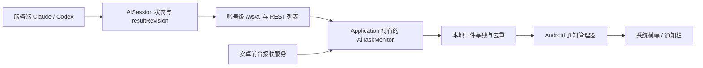

# 安卓后台通知分析与修复

本次用户确认的现象是：屏幕保持亮着，切到其他应用后收不到通知；返回 Terminal Buddy 后立即出现。此现象说明前台恢复后的同步能发现事件，不能据此认定是锁屏 Doze，也不能直接认定是系统通知渠道故障。缺少问题设备的后台日志时，尚不能确认究竟是服务启动失败、进程冻结还是后台网络被限制。

## 实际链路

CLI 任务在服务端独立运行，手机退后台不终止任务。手机对话页的 Socket 和首页轮询会在页面不可见时停止，这是正常设计；后台应由账号级通知连接接管。`AiTaskMonitor` 虽由 Application 持有，仍与 Activity 位于同一进程，不是由操作系统或云推送替 App 接收。

服务端账号级通知接口每秒读取会话元数据，每十秒发送空闲快照。Android 通过独立的 OkHttp 队列订阅，并用 REST 补偿。前台恢复时，页面和通知监听都会请求新快照，因此“回来就显示”并不能证明事件是在后台及时收到的。

## 已确认的代码问题

| 位置 | 旧实现 | 影响与本次调整 |
| --- | --- | --- |
| `MainActivity` / `AiTaskNotifications` | 从 `onStart` 申请服务，尚未进入 `Service.onCreate` 就设置 `serviceRunning=true` | 请求状态与真实运行状态混用，启动异常难以识别。改为在 `onResume` 发起，真实 `startForeground` 成功后才标记运行；十秒无响应和系统拒绝均记录异常，提供重试入口。不能仅凭源码证明旧的启动时机就是本次设备上的触发原因。 |
| `AiTaskMonitorService` / Manifest | 将长期消息接收声明为 `dataSync` | Android 15+ 对此类型施加每 24 小时累计六小时的后台配额，耗尽后现有服务主动退出，剩下的应用协程不具备保活能力。Android 14+ 改用准确声明用途的 `specialUse`；旧系统运行普通前台服务。 |
| `AiTaskMonitorService` | 仅已知任务运行时持有唤醒锁 | 空闲期间可能先失去接收能力，因而无法发现服务端后来产生的任务，也不能靠收到 `running` 后再持锁唤醒自己。服务存续期间持续持有带超时与续期的锁，停止服务时释放。 |
| `AiTaskMonitor` | 监听网络切换，但不区分系统对后台网络的限制 | 连接曾成功并不代表后台仍可联网。加入网络阻断状态与电源状态监听，解除限制或退出休眠后立即重连；在界面、常驻通知与诊断中显示联网受限。 |
| 通知基线 | 新出现且已结束的会话没有旧快照时，一律视作历史 | 在断线期间创建并完成的新会话可能永久不提醒。为账号持久化“已完成首次完整列表同步”的标记，首次接纳历史，此后补报新出现的已结束会话。 |
| 服务端 `notifications_socket` | 发送快照但不主动确认客户端回应，发送等待无单独限时 | 失效连接可能长时间残留。为通知摘要增加双向 Ping/Pong 存活检查、45 秒无回应回收、15 秒发送等待限制；任务和对话正文流不受此限制。 |
| 后台补偿 | 即使实时连接正常也每三秒轮询，服务健康检查还会主动打断轮询等待 | 增加耗电但无法唤醒被冻结的进程。健康时降为三十秒补偿，断线时三秒，失败时退避；健康检查只检查和恢复监听，不再不断触发 REST 请求。 |

登录账号的后台监听服务支持系统 sticky 重建，并在开机和覆盖升级广播中尝试恢复；这些恢复仍受系统限制。WorkManager 继续提供十五分钟周期的补偿，它是允许延迟的任务调度，不是实时推送机制。

## 为什么前几次修复仍可能无效

此前几次改动主要覆盖了“进程仍正常运行”这一前提下的问题：监听不随页面取消、多个账号独立连接、独立请求队列、断线重连、心跳超时和 REST 补偿。若手机进程已被冻结、服务实际没有启动或系统禁止后台联网，这些协程和定时器都无法继续及时执行。继续缩短轮询和重连周期不能解决这一层的问题。

本次修复覆盖应用能够控制的服务生命周期、运行类型、唤醒策略、网络恢复和事件基线问题；具体问题设备是否因此恢复，需要结合其实际后台状态确认，不能从源码改动推导为“所有手机已彻底解决”。

## 诊断入口与判读

打开「更多 → 通知设置」，先看「后台消息接收」的真实服务状态。出现问题并回到应用后，点击「复制通知诊断」，记录会保留本次前后台切换及此前进程的最近状态。报告不包含地址、令牌、对话正文或通知标题。

- 进入后台时服务未运行，或出现启动异常：优先看服务启动记录与系统错误类型。
- `系统限制后台网络：true`：操作系统已明确限制联网；需在应用系统设置允许后台联网，省流量模式下还需允许不受流量限制。
- 返回前台时出现新的进程 PID：此前进程已经消失。没有正常服务停止记录而发生进程重建，通常是系统直接回收或终止；仅凭应用日志不能确认是谁终止。
- 同一进程中最近通知帧与摘要同步都停在切换应用之前：应检查厂商后台冻结、系统网络限制及电池策略。没有日志并不等于不存在系统限制。
- 后台已有“通知已交给系统”记录：应用调用通知管理器已成功，应检查通知渠道、悬浮通知、声音、勿扰和厂商策略。该记录不是横幅已展示的回执。
- Socket 断开但摘要同步继续成功：后台进程和网络仍在工作，重点检查 WebSocket 代理与网络链路；REST 会继续补偿。

## 无法由本机长连接消除的边界

普通前台服务不会自动获得 Doze 网络豁免，唤醒锁也不能绕过 Doze。需要用户允许电池优化豁免、后台运行；部分手机另有自启动、后台冻结和最近任务保护策略，应用无法准确读取全部厂商开关。持续直连及持有唤醒锁会增加耗电。

如果要求在 App 进程被系统回收/冻结后仍由系统唤醒并展示通知，需要接入适合目标手机的系统推送：Google Play 环境下的 FCM，或对应手机厂商的推送服务，并让服务端注册设备并独立投递。当前仓库没有这些推送 SDK、设备注册和投递通道。`specialUse` 只是服务运行类型，不是系统推送；任何普通 App 也无法承诺在用户明确强行停止后仍正常收信。

这意味着：本次源码修复能改善直连模式并提供定位证据，但若问题设备仍由厂商冻结，后续正确方向是针对该设备接入系统推送，而不是继续堆叠重连、轮询或后台拉活代码。

## Android 官方说明

- [前台服务类型与 specialUse](https://developer.android.com/develop/background-work/services/fgs/service-types)
- [dataSync 等前台服务的时长限制](https://developer.android.com/develop/background-work/services/fgs/timeout)
- [Doze、网络访问与电池优化豁免](https://developer.android.com/training/monitoring-device-state/doze-standby)
